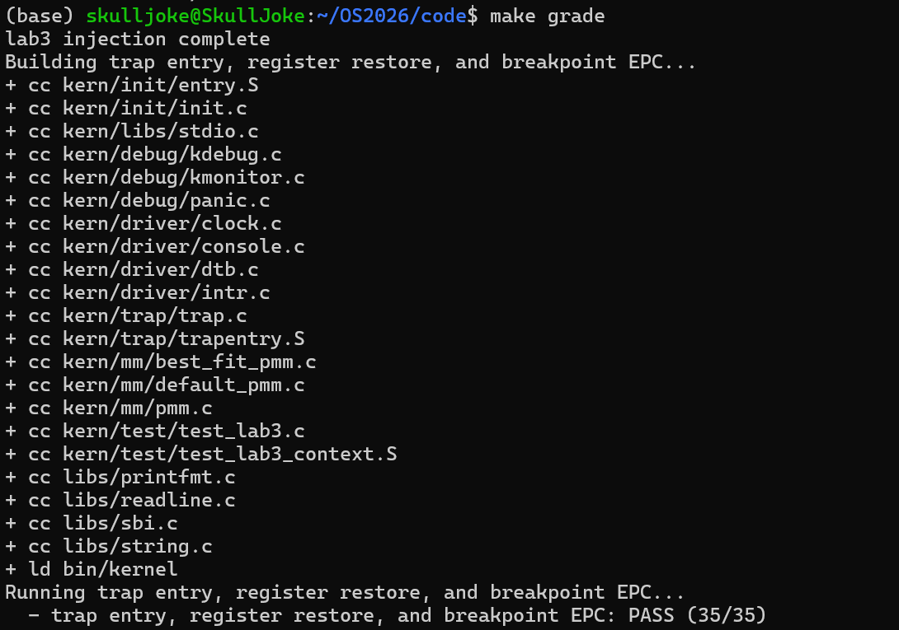
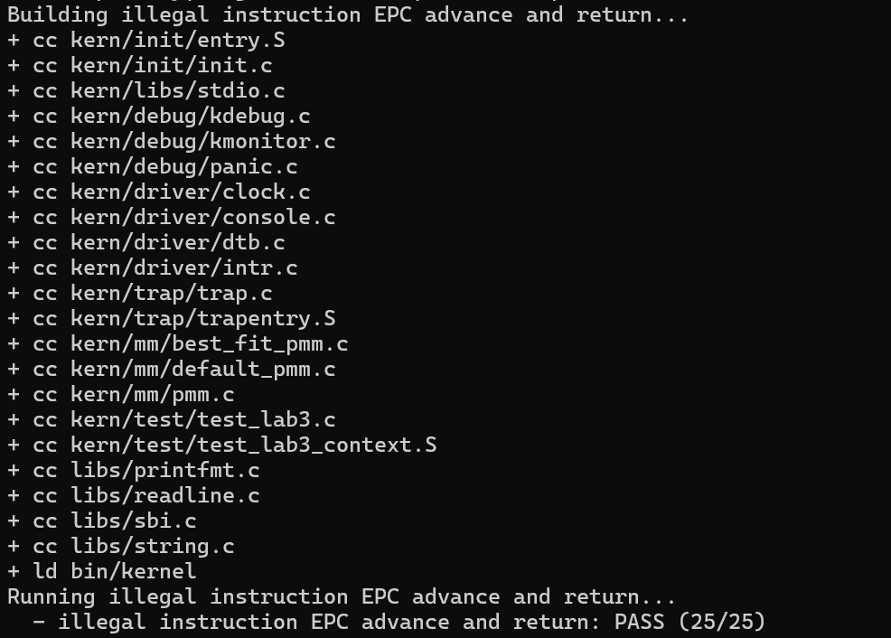
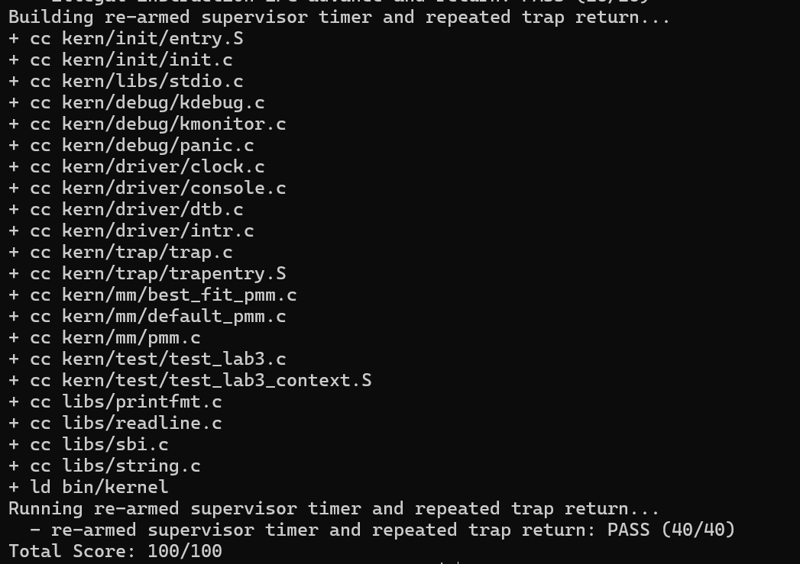

# 操作系统实验报告

## 实验基本信息

| 项目       | 内容                                 |
| -------- | ---------------------------------- |
| **实验名称** | Lab3：中断与异常处理                       |
| **小组成员** | 2411822-刘国全、2411350-刘爽、2413423-王乐妍 |
| **完成日期** | 2026-11-04                         |

### 小组分工

#### 练习分工：

| 成员 | 负责的练习/模块 |
|------|----------------|
| 刘国全 | `trapentry.S` 的 `RESTORE_ALL` 与 `__alltraps`、Test 1 上下文恢复测试 |
| 刘爽 | `trap.c` 的 `interrupt_handler`、Test 3 时钟中断测试 |
| 王乐妍 | `trap.c` 的 `exception_handler` 与指令长度判断、Test 2 异常测试、Prompt 汇总与报告整合 |

#### 报告分工：

| 报告部分 | 负责人 | 协作人 |
|----------|--------|--------|
| Trap 入口、上下文保存恢复 | 刘国全 | 王乐妍 |
| 中断处理、时钟中断、原子操作 | 刘爽 | 刘国全 |
| 异常处理、指令长度与 `sepc` 更新 | 王乐妍 | 刘爽 |
| 测试矩阵与截图 | 王乐妍 | 全员 |
| Prompt 统稿、报告整合与格式校对 | 刘国全、王乐妍 | 全员 |

---

## 一、实验目的

本实验的主要目的是：

1. 理解 RISC-V 特权级架构下中断与异常的统一 Trap 机制，掌握 Trap 的进入、处理和返回完整流程，以及 `stvec`、`sepc`、`scause`、`sstatus` 等控制状态寄存器在 Trap 过程中的作用。
2. 理解 Trap frame 的布局（32 个通用寄存器与 4 个 CSR，共 36 个 `uintptr_t`），掌握内核态保存与恢复被中断程序完整上下文的方法，理解汇编入口（`SAVE_ALL`/`RESTORE_ALL`）与 C 语言处理函数之间的协作和接口约定。
3. 实现时钟中断的持续触发和处理。
4. 区分同步异常（非法指令、断点）与异步中断（时钟、软件中断）在返回地址语义上的差异，掌握非法指令、断点异常的识别与 `sepc` 修正，理解为什么异常处理必须推进 `sepc` 才能避免死循环。
5. 了解中断开关、原子位操作与内核临界区保护之间的关系。
6. 继续实践以任务、上下文、接口、约束和验证方式组织 Prompt，对 AI 生成的底层代码进行审查、测试与集成。

---

## 二、实验环境

实验在 WSL2 的 Ubuntu 环境中完成，目标架构为 RISC-V 64 位，内核以 Sv39 分页方式运行。主要工具包括：

| 工具 | 用途 |
|------|------|
| `riscv64-unknown-elf-gcc` | 编译 RISC-V 内核 |
| `riscv64-unknown-elf-ld` | 链接内核 |
| `riscv64-unknown-elf-gdb` | 调试 guest 内核 |
| `qemu-system-riscv64` | 运行内核 |
| GNU Make、Python 3 | 构建工程与评分脚本 |
| Git | 版本管理 |

#### AI 工具配置

| 成员  | AI 编程工具                 | 底层模型                             | 配置            |
| --- | ----------------------- | -------------------------------- | ------------- |
| 刘国全 | Codex（VS Code/终端 Agent） | DeepSeek Flash（`deepseek-flash`） | 推理强度 high     |
| 刘爽  | 豆包（桌面端）                 | 具体模型版本未记录                        | 独立 WSL 环境补充验证 |
| 王乐妍 | Claude Code             | DeepSeek flash                   | 推理强度 high     |

---

## 三、实验整体逻辑分析

### 3.1 本章节的逻辑主线

本实验围绕"内核如何被事件打断并作出反应"展开。Lab2 完成物理内存管理后，内核仍无法感知时钟滴答、也无法响应程序的非法操作；Lab3 为内核装上统一的 Trap 处理通道。完整主链路如下：

```text
事件发生（中断或异常）
  -> 硬件写入 sepc / scause / sstatus，PC 跳转到 stvec 指向的 __alltraps
  -> SAVE_ALL 压栈 31 个通用寄存器与 4 个 CSR，形成 struct trapframe
  -> __alltraps 以 sp 为参数调用 C 函数 trap(tf)
  -> trap_dispatch() 按 scause 最高位分流：
       最高位 = 1（异步中断） -> interrupt_handler(tf)
       最高位 = 0（同步异常） -> exception_handler(tf)
  -> __trapret 按相反顺序 RESTORE_ALL
  -> sret 按（可能已被处理函数修改的）sepc 返回
```

其中，`trapentry.S` 解决"上下文如何完整保存与恢复"，`trap_dispatch()` 解决"事件如何分类"，`interrupt_handler()` 与 `exception_handler()` 分别解决"中断如何响应"与"异常如何恢复执行"。三个模块通过冻结的 `struct trapframe`（36 个 `uintptr_t`）接口解耦，三人并行开发后一次性集成。各环节的实现细节分别见第四章三个功能模块。

### 3.2 功能的逐步实现

1. **冻结接口。** 三人先确认 `struct trapframe` 布局（32 个通用寄存器与 `sstatus`、`sepc`、`sbadaddr`、`scause` 共 36 个 `uintptr_t`）与 `trap()`、`interrupt_handler()`、`exception_handler()` 的函数签名，保证并行开发互不等待。
2. **实现 Trap 入口。** `SAVE_ALL` 与 `RESTORE_ALL` 偏移一一对应，`sp` 经 `sscratch` 特殊处理，`__alltraps` 按 RISC-V ABI 把 trapframe 指针交给 C 函数（刘国全负责，详见 4.1 节）。
3. **实现中断处理。** 时钟中断每次重新武装下一次事件，`ticks` 累计并按周期打印、达到阈值关机，未知中断兜底输出（刘爽负责，详见 4.2 节）。
4. **实现异常处理。** 识别非法指令与断点，按 RVC 编码判断指令真实长度并推进 `tf->epc`，其余异常交由 `print_trapframe()` 兜底（王乐妍负责，详见 4.3 节）。
5. **集成与验证。** 合并 `trap.c`，迁移 Lab2 依赖代码使骨架可编译，运行 Test 1/2/3 与最终 `make grade` 确认 100/100。

---

## 四、实验内容与实现

### 4.1 功能模块：Trap 入口与上下文保存恢复

**负责人：**2411822-刘国全
**文件：**`code/kern/trap/trapentry.S`

#### Trap frame 布局

```c
struct pushregs {
    uintptr_t zero, ra, sp, gp, tp;
    uintptr_t t0, t1, t2;
    uintptr_t s0, s1;
    uintptr_t a0, a1, a2, a3, a4, a5, a6, a7;
    uintptr_t s2, s3, s4, s5, s6, s7, s8, s9, s10, s11;
    uintptr_t t3, t4, t5, t6;
};

struct trapframe {
    struct pushregs gpr;
    uintptr_t status;
    uintptr_t epc;
    uintptr_t badvaddr;
    uintptr_t cause;
};
```

Trap frame 偏移：

```text
0  ~ 31  * 8：通用寄存器 x0 ~ x31
32 * 8：sstatus
33 * 8：sepc
34 * 8：sbadaddr
35 * 8：scause
```

#### `RESTORE_ALL`

实现逻辑：

1. 从 `2*REGBYTES(sp)` 恢复原 `sp` 到 `sscratch`；
2. 从 `32*REGBYTES(sp)` 恢复 `sstatus`；
3. 从 `33*REGBYTES(sp)` 恢复 `sepc`；
4. 从 `34*REGBYTES(sp)` 恢复 `sbadaddr`；
5. 从 `35*REGBYTES(sp)` 恢复 `scause`；
6. 恢复 x1、x3~x31；
7. 最后恢复 x2/sp，避免提前改变 Trap frame 的基址。

#### `__alltraps`

```asm
__alltraps:
    SAVE_ALL
    mv a0, sp
    jal trap
    j __trapret
```

- `SAVE_ALL` 在栈顶构造 Trap frame；
- `mv a0, sp` 将 Trap frame 地址作为 `trap(struct trapframe *tf)` 的第一个参数；
- `jal trap` 调用 C 语言处理函数；
- `j __trapret` 进入上下文恢复和 `sret` 返回路径。

#### Spec

```text
Pre-Condition:
  CPU 已根据 stvec 进入 __alltraps；
  sscratch 中保存进入 Trap 前的 sp；
  当前栈上有足够空间容纳 36 个 uintptr_t。

Post-Condition:
  RESTORE_ALL 恢复 sstatus、sepc、sbadaddr、scause 和全部通用寄存器；
  sscratch 恢复为进入 Trap 前的 sp；
  sp 最后恢复为进入 Trap 前的值；
  __trapret 执行 sret，返回原执行流。

Failure:
  如果先恢复 sp，后续将失去 Trap frame 地址；
  如果 CSR 恢复晚于通用寄存器恢复，临时寄存器会被覆盖；
  如果 trapframe 偏移不一致，寄存器和 CSR 会恢复错误。
```

#### 验证状态

`trapentry.S` 单独编译成功：

```text
+ cc kern/trap/trapentry.S
```

反汇编确认入口与返回路径：

```text
__alltraps:
  csrw sscratch, sp
  ...
  mv a0, sp
  jal trap
  j __trapret

__trapret:
  ...恢复 CSR 和通用寄存器...
  ld sp, 16(sp)
  sret
```

Lab3 全部模块合并后运行 Test 1（Trap 入口、寄存器恢复与断点 EPC），结果 PASS (35/35)，确认 `__alltraps -> trap() -> __trapret -> sret` 完整链路与上下文恢复均正确。

---

### 4.2 功能模块：中断处理与时钟中断

**负责人：**2411350-刘爽
**文件：**`code/kern/trap/trap.c`

#### `interrupt_handler`

实现内容：

1. 从 `tf->cause` 中屏蔽最高位，取出中断原因编号；
2. `IRQ_S_TIMER`：
   - `ticks++`；
   - 每 `TICK_NUM` 次输出统计；
   - 调用 `clock_set_next_event()` 设置下一次时钟中断；
   - 达到 `SHUTDOWN_AFTER` 后调用 `sbi_shutdown()`；
3. `IRQ_S_SOFT`：输出软件中断提示；
4. 未知中断：输出原因并调用 `print_trapframe(tf)`。

关键代码逻辑：

```c
uintptr_t cause_code =
    tf->cause & (((uintptr_t)1 << 63) - 1);

switch (cause_code) {
case IRQ_S_TIMER:
    ticks++;
    if (ticks % TICK_NUM == 0)
        print_ticks();
    clock_set_next_event();
    if (ticks >= SHUTDOWN_AFTER)
        sbi_shutdown();
    break;
case IRQ_S_SOFT:
    cprintf("Supervisor software interrupt\n");
    break;
default:
    cprintf("Unknown interrupt: cause %d\n", (int)cause_code);
    print_trapframe(tf);
}
```

#### Spec

```text
Pre-Condition:
  trap_dispatch() 已判断 tf->cause 是中断；
  clock_init() 已设置第一个时钟事件；
  sstatus.SIE 已打开。

Post-Condition:
  每次时钟中断重新设置下一次事件；
  ticks 每次加一；
  ticks 为 TICK_NUM 整数倍时输出统计；
  ticks 达到 SHUTDOWN_AFTER 后关机；
  软件中断和未知中断有对应输出。
```

#### 验证状态

Lab3 全部模块合并后运行 Test 3（持续时钟中断与多次 Trap 返回），结果 PASS (40/40, `ticks=200`)：时钟中断持续重新武装、`ticks` 按次累计并周期性输出 `100 ticks`、达到关机条件后正常关机；Test 2 中软件中断输出 `Supervisor software interrupt`、未知中断兜底输出 `Unknown interrupt: cause 15` 均验证通过。

---

### 4.3 功能模块：异常处理与指令长度判断

**负责人：**2413423-王乐妍

#### 模块功能描述

**需要实现/修改的函数：**

```c
void exception_handler(struct trapframe *tf);      // kern/trap/trap.c
static size_t trap_insn_len(uintptr_t epc);        // 模块内静态辅助函数
```

**功能说明：**

异常是当前指令执行引起的同步事件。与中断不同，硬件写入 `sepc` 的是**引发异常的那条指令本身**的地址：如果处理函数不修改 `epc` 就返回，`sret` 会重新执行同一条指令，再次触发同一异常，形成无限循环。因此本模块的核心职责是：

1. 根据 `tf->cause` 识别异常类型（`scause` 最高位为 0 时由 `trap_dispatch()` 进入本函数，cause 为小整数，无需屏蔽最高位）；
2. 对实验要求处理的两种异常按规定格式输出并**把执行位置推进到异常指令之后**；
3. 对其余异常调用框架提供的 `print_trapframe(tf)` 兜底显示完整 Trap frame。

指令推进量的确定依赖 RISC-V 压缩指令集（RVC）的编码规则：指令可能是 2 字节压缩指令或 4 字节标准指令，长度由指令最低 2 位决定——不等于 `0b11` 时为 2 字节，否则为 4 字节。因此不能对所有异常假定固定偏移，必须在运行时读取 `tf->epc` 处的半字动态判断。

与其他模块的衔接：本函数只依赖冻结的 `struct trapframe`，既不感知 `trapentry.S` 如何压栈，也不与 `interrupt_handler()` 产生任何共享状态；Test 1 中 `ebreak` 指令触发的断点异常同样由本函数的断点分支输出，因此 Test 1 与 Test 2 存在联合验证关系。

#### 核心实现

```c
/* trap_insn_len - return the byte length of the instruction at epc.
 * RVC: the low 2 bits == 0b11 means a 32-bit instruction, otherwise
 * the instruction is a 16-bit compressed one. */
static size_t
trap_insn_len(uintptr_t epc) {
    unsigned short insn = *(unsigned short *)epc;
    return ((insn & 0x3) == 0x3) ? 4 : 2;
}

void
exception_handler(struct trapframe *tf) {
    switch (tf->cause) {
    case CAUSE_ILLEGAL_INSTRUCTION: {   /* cause = 2 */
        cprintf("Illegal instruction at 0x%08x\n", tf->epc);
        tf->epc += trap_insn_len(tf->epc);  /* skip faulting insn */
        break;
    }

    case CAUSE_BREAKPOINT: {            /* cause = 3, ebreak */
        cprintf("Breakpoint at 0x%08x\n", tf->epc);
        tf->epc += trap_insn_len(tf->epc);  /* resume after ebreak */
        break;
    }

    default:                            /* unhandled exception: dump frame */
        print_trapframe(tf);
        break;
    }
}
```

实现要点：

1. **只对需要推进 `epc` 的分支读内存。** `trap_insn_len()` 解引用 `epc` 仅发生在非法指令与断点两个分支；兜底分支不做任何内存访问——测试会用 `memset` 清零的合成 trapframe 直接调用本函数，此时 `epc` 为 0，不指向任何有效指令，读它没有意义也不安全。
2. **以半字粒度读取指令。** 用 `unsigned short` 读取 `epc` 处低 16 位即可判断长度，避免按 32 位读取时的对齐问题。
3. **输出格式与评分契约对齐。** `Illegal instruction at`、`Breakpoint at` 是 `tools/grade.sh` 匹配的关键子串。

**Spec**

```text
Pre-Condition:
  tf 指向一个合法的 trapframe，可能来自真实 Trap（SAVE_ALL 压栈产物），
  也可能是测试构造的合成帧；本次调用来自异常分支（cause 最高位为 0）。

Post-Condition:
  非法指令与断点异常：已输出符合评分契约的记录，且 tf->epc 已按异常指令
  的真实长度前进，保证 sret 返回后不会再次执行同一条指令；
  其余异常：已调用 print_trapframe(tf) 输出完整 Trap frame，执行位置不变；
  除 epc 外不修改 trapframe 的任何字段，不修改任何全局状态。

Failure:
  cause 为未知异常码时走兜底分支；此时 epc 可能不指向有效指令，
  处理过程不得读取该地址处的内存。
```

#### 最终提示词

以下是最终使用的提示词（四段式结构），生成代码一次通过编译与全部相关测试：

````markdown
[PROMPT]
**任务**：修改文件 code/kern/trap/trap.c，在 `//lab3 function3` 标记处实现
exception_handler() 函数，完成异常处理功能：识别非法指令异常与断点异常并按规定
格式输出、根据指令实际长度更新 tf->epc、其余异常调用 print_trapframe() 兜底。

**操作要求**：你必须在项目中修改实际文件，而不是仅展示代码。保留文件中所有现有
代码，只在标记位置插入新实现，不得修改任何既有函数的函数体或签名。若
exception_handler 缺少声明，可在 kern/trap/trap.h 中补充其函数声明。

**输出要求**：直接进行文件操作。使用下面 [RELY]、[GUARANTEE]、[SPECIFICATION]
部分的信息，以工程真实代码为准，不要引入无关功能。

[RELY]
// 数据结构（kern/trap/trap.h）
struct trapframe {
    struct pushregs gpr;
    uintptr_t status;
    uintptr_t epc;
    uintptr_t badvaddr;
    uintptr_t cause;
};

// 异常编码宏（libs/riscv.h）
#define CAUSE_ILLEGAL_INSTRUCTION 0x2
#define CAUSE_BREAKPOINT          0x3

// 可用函数（分别位于kern/trap/trap.c和libs/stdio.h）
void print_trapframe(struct trapframe *tf);
int  cprintf(const char *fmt, ...);

// 调用点（trap.c，不要改动）
static inline void trap_dispatch(struct trapframe *tf) {
    if ((intptr_t)tf->cause < 0)
        interrupt_handler(tf);    // 中断分支（队友已实现）
    else
        exception_handler(tf);    // 异常分支（本任务要实现）
}

[GUARANTEE]
必须实现的主要接口：
```c
void exception_handler(struct trapframe *tf);
```
你可以根据需要添加：
- 辅助函数 static size_t trap_insn_len(uintptr_t epc)
- 内部使用的宏定义（如有必要）

[SPECIFICATION]
## exception_handler
**Pre-Condition**:
- tf 指向一个合法的 trapframe，cause 最高位为 0。

**Post-Condition**:
- 对实验明确要求处理的两种异常：已识别异常类型、已输出符合 RELY 评分契约的
  记录，并使帧处于"返回后不会再次执行同一条异常指令"的状态；
- 对其余异常：已交由框架既有的 Trap frame 输出兜底，且未改变执行位置；
- 除执行位置（epc）外，未修改其它已保存上下文，也未改动任何全局状态。

  **Case 1（非法指令）**:
  - 触发条件：cause 为非法指令异常码；
  - 行为与最终状态：输出可被评分识别为非法指令、并携带当前异常地址的记录；
    帧中的执行位置前进到触发异常指令的下一条指令，前进量等于该指令的真实长度。

  **Case 2（断点）**:
  - 触发条件：cause 为断点异常码；
  - 行为与最终状态：与 Case 1 类似，但输出需可被评分识别为断点；此分支同时被
    Test 1 的 ebreak 触发，输出须与评分契约一致。

  **Case 3（其他异常）**:
  - 触发条件：任何实验未要求专门处理的异常码（含测试直接注入的未知 cause）；
  - 行为与最终状态：保持执行位置不变，将整个帧交给框架既有的输出函数显示。

**Requirements**:
- 执行位置的前进量必须由异常指令的真实长度决定（编码规则见 RELY），禁止对
  所有异常假定固定偏移；
- 函数签名与可修改函数范围以 GUARANTEE 为准；工程以 GNU C99 且 -Wall -Werror
  编译，不得引入隐式声明等告警。

## 指令长度辅助函数（可选）
**Pre-Condition**: epc 指向内核地址空间中一条有效指令的起始地址。
**Post-Condition**: 得到该指令所占的字节数；不修改任何状态。
````

> 注：[RELY] 中的领域事实还包含三条（此处从报告正文引用，实际提示词中均已写入）：
> RISC-V 指令最低 2 位不等于 `0b11` 时为 2 字节压缩指令、否则为 4 字节；
> `tools/grade.sh` 的输出契约要求包含 `Illegal instruction at`、`Breakpoint at` 等子串；
> 测试会用 `memset` 清零的合成 trapframe 直接调用本函数，此时 `epc` 可能为 0。

#### 实现迭代过程

本模块的实现经历了 2 次迭代，过程如下：

##### 第一次迭代

**最终结果：**

使用上述提示词生成 `exception_handler()` 与 `trap_insn_len()`，审查确认：

- 三种 cause 分支齐全，输出格式与评分契约一致；
- EPC 前进量由 `trap_insn_len()` 按指令真实长度动态决定，未写死偏移；
- 兜底分支不读 `epc` 内存，合成帧（`epc = 0`）调用安全；

##### 第二次迭代

**遇到的问题：**

- 问题1：`make grade` 无法编译，报 undeclared identifier。原因不在本模块：Lab3 骨架中 `best_fit_pmm.c` 与 `pmm.c` 里标有 `//lab2 请补充` 的占位位置尚未填写，实验依赖的 Lab2 代码（Best-Fit 分配器实现、`page_init()`）未迁移，而框架自带的检查函数引用了这些实现才定义的符号。

**问题解决策略：**

- 针对问题1：按实验指导书要求处理——指导书明确"本实验依赖实验2。请使用你此前设计的提示词生成相应实验代码，并将生成结果填写到本实验代码中标有 lab2 注释的对应位置，确保代码能够正确编译"。据此取出 Lab2 时设计并记录在 Lab2 报告中的两份提示词（`page_init()` 提示词与 Best-Fit 分配器提示词），重新生成相应实验代码，并将生成结果填写到 Lab3 骨架中 `best_fit_pmm.c` 与 `pmm.c` 标有 lab2 注释的对应位置，重新生成并填入后编译通过。

##### 关键改进点总结

1. 在 [SPECIFICATION] 中预先写明"前进量由指令真实长度决定，禁止固定偏移"，将 RVC 编码规则作为领域事实放入 [RELY]，避免了最常见的 EPC 前进错误；
2. 预先约定"兜底分支禁止读取 epc 处内存"，覆盖测试直接注入未知 cause、`epc` 无效的边界场景，避免未知异常漏处理或非法访存；
3. 输出格式直接对齐 `grade.sh` 的匹配子串，避免"功能正确但评分不识别"的返工。

---

## 五、测试与验证

### 5.1 测试环境说明

测试在 WSL2 中 `~/OS2026/code` 目录下执行。

与 Lab2 相同，Windows 工作区 Git 的 `core.autocrlf` 使 `tools/grade.sh` 被检出为 CRLF，WSL 的 `/bin/sh` 无法解析行尾 `\r`，首次运行 `make grade` 报语法错误。转换换行符后恢复正常。

### 5.2 测试矩阵

`make grade` 会对每个测试单独构建内核并在 QEMU 中运行（因此每个测试结果前都有一段编译输出）：

| 测试                                                        | 验证内容                                                      | 主要负责人 | 协作人 | 结果           |
| --------------------------------------------------------- | --------------------------------------------------------- | ----- | --- | ------------ |
| Test 1：trap entry, register restore, and breakpoint EPC   | Trap 入口完整流程、`ebreak` 触发断点异常后寄存器上下文恢复、断点 EPC 推进            | 刘国全   | 王乐妍 | PASS (35/35) |
| Test 2：illegal instruction EPC advance and return         | 非法指令异常识别与输出、按指令长度推进 EPC 并正确返回、未知异常兜底（含直接注入 cause=20 的合成帧） | 王乐妍   | 刘爽  | PASS (25/25) |
| Test 3：re-armed supervisor timer and repeated trap return | 时钟中断持续触发与重新武装、`ticks` 累计、多次 Trap 返回、关机条件                  | 刘爽    | 刘国全 | PASS (40/40) |

### 5.3 测试结果

Test 1（Trap 入口、寄存器恢复与断点 EPC，其中断点输出由 `exception_handler` 的断点分支产生，为本模块与 Test 1 的联合验证点）：



Test 2（非法指令 EPC 推进与返回，本模块的主要验证项）：



Test 3 与最终总分：



最终评分：

```text
trap entry, register restore, and breakpoint EPC:      PASS (35/35)
illegal instruction EPC advance and return:            PASS (25/25)
re-armed supervisor timer and repeated trap return:    PASS (40/40)
Total Score: 100/100
```

Test 1/2 的联合验证说明：Test 1 通过断点异常验证了"汇编入口 → `trap()` → 异常分支 → 修改 `epc` → `RESTORE_ALL` → `sret` 返回后寄存器与 `epc` 均为预期值"的完整链路，其中"断点 EPC 推进"与"`Breakpoint at` 输出"正是 `exception_handler` 断点分支的行为；Test 2 进一步单独验证非法指令分支的压缩指令长度判断与未知异常兜底。两个测试共同确认了异常处理模块在真实 Trap 路径与合成 Trap frame 两种输入下行为一致。

---

## 六、实验总结与收获

### 对操作系统的理解

| 本实验中的知识点 | 对应 OS 原理 | 含义、关系与差异 |
|------------------|--------------|------------------|
| `stvec`/`sepc`/`scause`/`sstatus` | Trap 机制的硬件基础 | 硬件在 Trap 时自动完成"记录现场、跳转入口"，软件负责"保存现场、分类处理、恢复现场"。`sepc` 既是被打断位置的记录，也是处理函数可以修改的返回点。 |
| 同步异常 vs 异步中断 | 事件分类与返回语义 | 中断来自外部设备，`sepc` 指向未执行的下一条指令，处理函数无须修改返回点；异常由当前指令引起，`sepc` 指向惹祸指令本身，必须推进 `epc` 才能避免重复执行。二者共用一条 Trap 通道，以 `scause` 最高位区分。 |
| `SAVE_ALL`/`RESTORE_ALL` | 上下文保存与恢复 | 二者完成一次 Trap 的现场保存和恢复；真正的进程上下文切换还会切换页表、栈和调度状态。 |
| RVC 压缩指令与指令长度 | 指令集编码 | RISC-V 指令定长 4 字节是常见误解，压缩指令扩展使指令可为 2 字节。任何"跳过当前指令"的逻辑都必须按编码动态判断长度，这也是异常处理与指令集编码的交叉点。 |
| `sret` | 特权级返回 | `sret` 根据 `sstatus.SPP` 等状态返回；本实验只做内核态 Trap，尚未完整实现用户态切换。 |
| 时钟中断 | 抢占式调度基础 | 时钟中断提供时间片和系统节拍；本实验只累计 ticks，尚未实现调度器。 |
| Trap frame 与进程上下文 | 上下文快照与进程切换基础 | `struct trapframe` 是被中断程序完整 CPU 状态的快照。后续实验中它将成为进程描述符的一部分：进程切换本质上是"保存 trapframe、切换执行流"。 |
| `local_intr_save/restore` 与原子位操作 | 中断屏蔽与临界区 | Lab3 框架将 `alloc_pages()` 等接口包上中断保护：中断来临后时钟回调等路径可能重入分配器，通过关中断和原子指令避免共享状态被破坏，是最简单的临界区手段，也是本实验与内存管理模块的衔接点。 |

本实验没有涉及的重要 OS 知识点：

- 用户态与内核态的完整切换（`sret` 特权级转换 Challenge）；
- 系统调用分发与参数检查（`ecall` 异常）；
- 进程创建、调度与上下文切换（trapframe 如何演变为进程切换的保存载体）；
- 缺页异常与按需分页（Lab4 内容，异常处理的第一个"真正用途"）；
- 多核中断、IPI 与 TLB shootdown；
- 嵌套 Trap、中断优先级与中断控制器（如 PLIC）的仲裁；
- 设备驱动与完整 I/O 中断；
- 中断并发下的锁与内存一致性。

### AI 协作开发的经验

1. **把边界条件写进 Spec，而不是事后修补。** 异常处理模块一次通过的关键在于提示词阶段就锁定了三个易错点：RVC 长度规则、评分输出契约、合成帧 `epc = 0` 时禁止读内存。Spec 描述"必须满足的行为与最终状态"、把具体写法留给 AI，同时以领域事实和评分契约锚定关键细节，是这套四段式提示词有效的原因。
2. **Trap frame 的字段偏移必须与汇编严格一致，不能只根据自然语言描述生成代码。** AI 给出的寄存器恢复顺序需要人工检查，尤其是 `sp` 和 CSR 的恢复时机。
3. **中断处理必须同时考虑正常路径、未知路径和持续触发路径。** 时钟中断"只触发一次"、关机条件过早都是这三类路径遗漏的典型表现。
4. **生成代码后必须实际编译、反汇编或运行测试，不能只接受自然语言解释。**
5. **编译失败要先区分"本模块问题"与"依赖问题"。** 本次 `make grade` 失败的根因是 Lab2 代码未按指导书要求迁移到 Lab3 骨架，与异常处理模块逻辑无关。定位时应先看报错符号属于谁，避免让 AI 在正确的代码上"修复"不存在的问题。
6. **环境问题与逻辑问题分开记录。** CRLF 换行符导致的评分脚本语法错误连续两次实验出现，属于工作区配置问题；把它固化到报告的测试环境说明中，可以避免队友重复排查。
7. **报告记录必须与实际验证状态一致。** 阶段报告中未完成的模块和测试不能提前写成通过，最终结果必须在代码完整后重新运行确认再更新报告。
