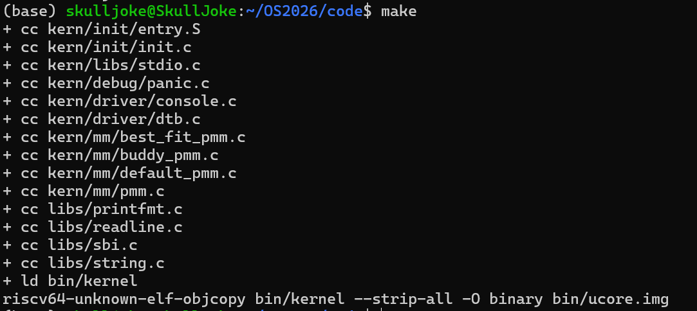
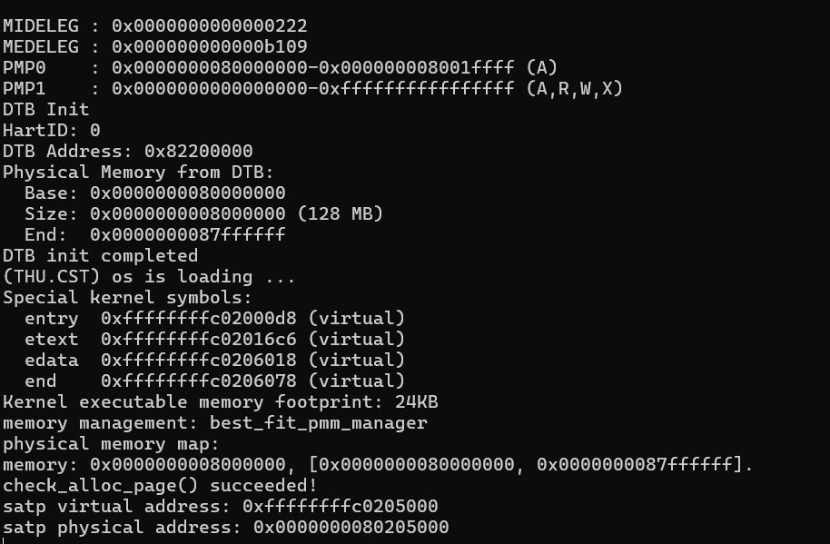
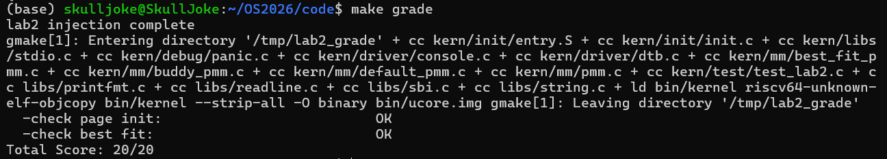
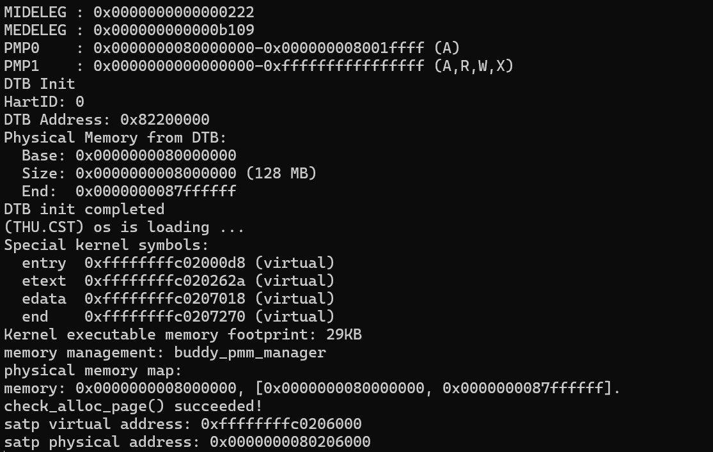
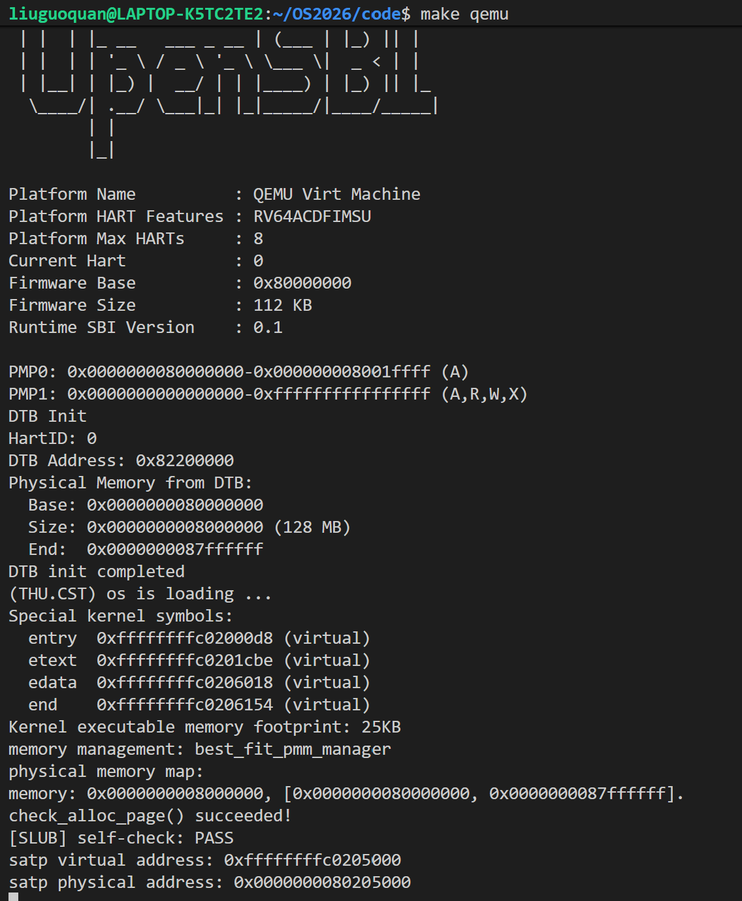
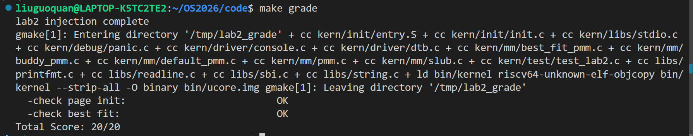
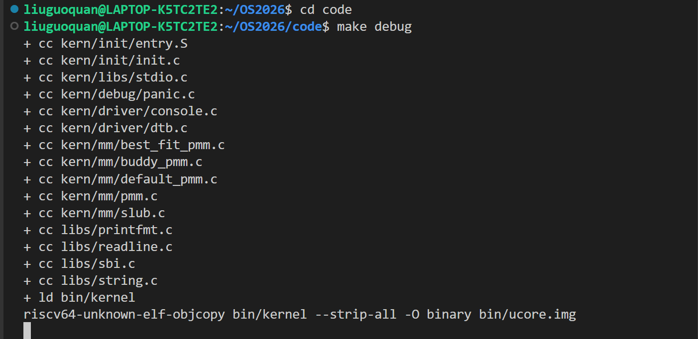
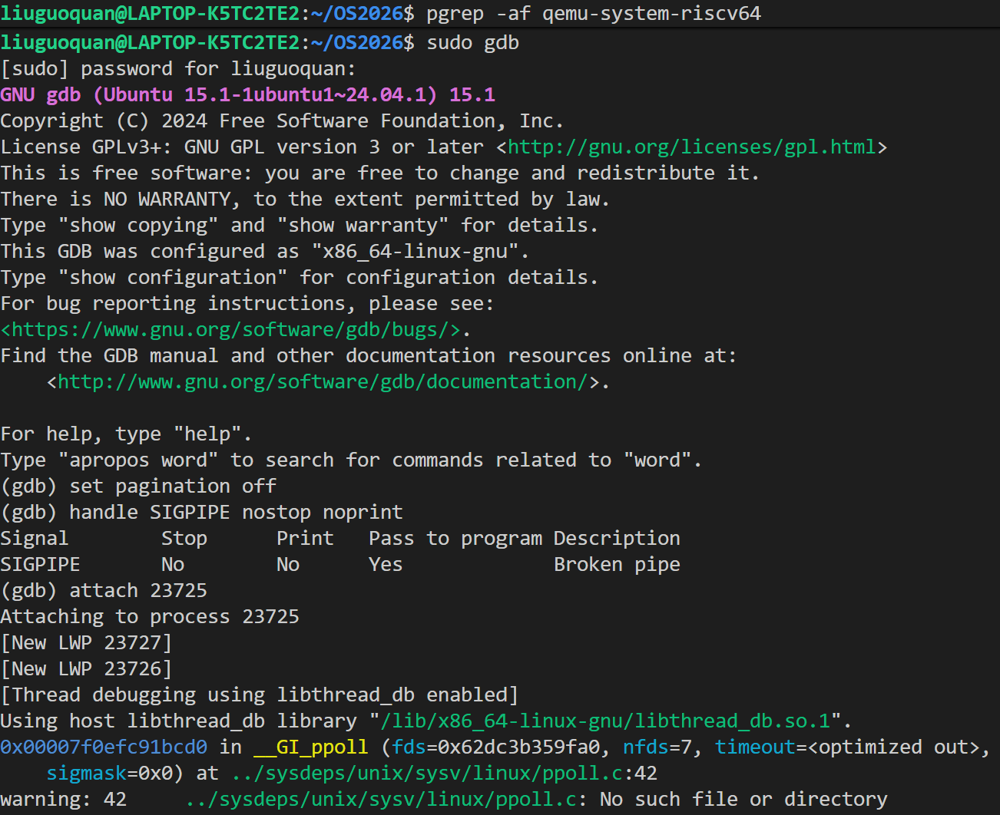
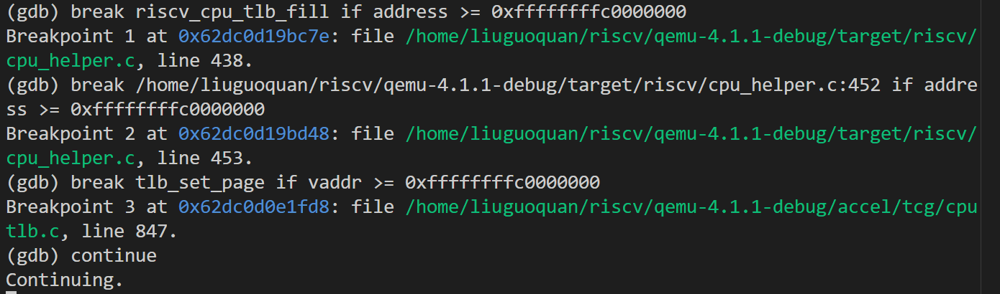
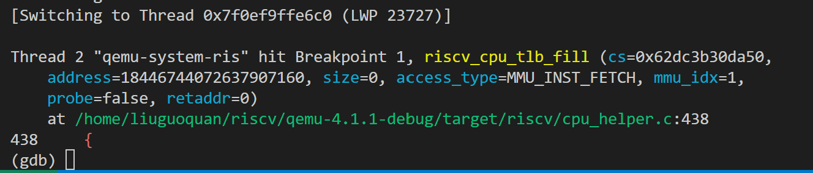

# 操作系统实验报告

## 实验基本信息

| 项目 | 内容 |
|------|------|
| **实验名称** | Lab2：物理内存和页表 |
| **小组成员** | 2411822-刘国全、2411350-刘爽、2413423-王乐妍 |
| **完成日期** | 2026-10-25 |

### 小组分工

#### 练习分工：

| 成员 | 负责的练习/模块 |
|------|----------------|
| 刘国全 | 环境配置、物理内存探测、`page_init()`、PMM 集成、QEMU MMU 调试、SLUB Challenge 与最终集成 |
| 刘爽 | Best-Fit 分配器、分配器切换与 Best-Fit 测试 |
| 王乐妍 | First-Fit 分析、Buddy System、Prompt 与实验报告整理 |

#### 报告分工：

| 报告部分 | 负责人 | 协作人 |
|----------|--------|--------|
| 实验目的、实验环境 | 刘国全 | 全员 |
| 物理内存初始化 | 刘国全 | 刘爽 |
| First-Fit 分析 | 王乐妍 | 刘国全 |
| Best-Fit 实现与测试 | 刘爽 | 王乐妍 |
| Buddy System 与测试 | 王乐妍 | 刘爽 |
| SLUB Challenge | 刘国全 | 王乐妍 |
| QEMU/GDB 调试 | 刘国全 | 刘爽 |
| Prompt、原理总结与报告校对 | 王乐妍 | 全员 |
| 代码集成与最终验证 | 刘国全 | 全员 |

---

## 一、实验目的

本实验的主要目的是：

1. 理解操作系统从设备树发现物理内存，并通过 `Page` 描述符组织物理页的基本方法。
2. 掌握 First-Fit 和 Best-Fit 连续物理页分配器的空闲链表维护、页块拆分与释放合并流程。
3. 通过实现多 order 空闲链表、2 的幂次块拆分和伙伴合并，理解 Buddy System 的设计思想及外部碎片问题。
4. 学会以任务、上下文、接口、约束和验证方式组织 Prompt，并对 AI 生成的底层代码进行审查与测试。

---

## 二、实验环境

实验在 WSL2 的 Ubuntu 24.04.1 LTS 环境中完成，目标架构为 RISC-V 64 位。

主要工具包括 GNU Make、Python 3、`riscv64-unknown-elf-` 交叉编译工具链、`qemu-system-riscv64` 和 GDB。内核以 Sv39 分页方式运行，物理内存范围和页描述符布局由启动阶段及 DTB 初始化结果确定。


#### AI 工具配置

| 成员 | AI 编程工具 | 底层模型 | 配置 |
|------|------------|---------|-------------|
| 刘国全 | Codex（VS Code/终端 Agent） | DeepSeek Flash（`deepseek-flash`） | 推理强度 high |
| 刘爽 | 豆包（桌面端） | 具体模型版本未记录 | 独立 WSL 环境补充验证 |
| 王乐妍 | Claude Code | DeepSeek flash | 推理强度 high |

---

## 三、实验整体逻辑分析

### 3.1 本章节的逻辑主线

本实验围绕“内核如何发现、组织和分配物理内存”展开。内核启动后先建立高地址虚拟映射，接着从设备树获取物理内存范围；`page_init()` 根据内核结束位置建立 `Page` 描述符数组，保留 OpenSBI、内核镜像、启动页表和描述符数组占用的页面，再把剩余连续空闲页交给当前 `pmm_manager`。之后的页面申请和释放统一通过 `alloc_pages()`、`free_pages()` 调用具体分配器。

实验在已有 First-Fit 的基础上实现 Best-Fit，并进一步使用 2 的幂次块、伙伴索引和逐级合并实现 Buddy System。完整主链路如下：

```text
entry.S
  -> kern_init()
  -> dtb_init()
  -> pmm_init()
  -> init_pmm_manager()
  -> page_init()
  -> init_memmap()
  -> check_alloc_page()
  -> alloc_pages() / free_pages()
```

其中，`page_init()` 解决“哪些物理页可以管理”，PMM 管理器解决“如何把可用页分配给调用者”，Best-Fit 和 Buddy System 则是对分配策略的不同实现。启动页表同时建立了内核虚拟地址和物理地址之间的固定偏移关系，为后续页表调试和更高地址运行提供基础。

### 3.2 功能的逐步实现

1. **建立启动地址环境。** 启动汇编建立 Sv39 页表并设置 `satp`，使内核从高虚拟地址继续执行，同时保持内核虚拟地址与物理地址之间可计算的固定偏移。
2. **探测物理内存。** `dtb_init()` 从设备树获取内存基地址和大小，确定当前 QEMU 环境中可管理的物理内存范围。
3. **建立页描述符。** 在 `end` 之后放置 `struct Page` 数组，为每个可管理物理页保存引用计数、保留状态和空闲块信息。
4. **注册初始空闲区。** 排除固件、内核和描述符数组所占区域后，把页对齐的完整空闲页交给 `init_memmap()`。
5. **分析并实现分配策略。** 先通过 First-Fit 理解地址有序链表、页块拆分和左右合并，再实现 Best-Fit 并切换 `pmm_manager`。
6. **扩展 Buddy System。** 使用多个 order 的空闲链表维护 2 的幂次块，完成按 order 向上查找、逐层拆分、伙伴计算和释放合并。
7. **验证管理链路。** 通过 `check_alloc_page()`、课程注入测试和 Buddy 自检验证初始化、分配、释放及计数是否正确。

---

## 四、实验内容与实现

### 4.1 物理内存初始化功能

#### 4.1.1实现物理内存探测与页描述符初始化功能

**模块目标**

根据设备树报告的物理内存范围，建立覆盖所有可管理物理页的 `struct Page` 描述符数组，并把 OpenSBI、内核镜像、启动页表和描述符数组之外的完整空闲页交给当前 `pmm_manager`。

**核心实现**

`page_init()` 位于 `kern/mm/pmm.c`，主要步骤如下：

1. 调用 `get_memory_base()` 和 `get_memory_size()` 获取 DTB 内存范围，计算 `mem_end`；
2. 设置 `va_pa_offset = PHYSICAL_MEMORY_OFFSET`；
3. 计算 `npage = PPN(mem_end)`，描述符覆盖 `[nbase, npage)`；
4. 将描述符数组起点设为 `ROUNDUP(end, PGSIZE)`；
5. 将全部描述符初始化为保留状态，防止未完成布局的页面进入空闲链表；
6. 用 `PADDR()` 求描述符数组的物理结束地址；
7. 将 `free_start_pa` 向上取整，将 DTB 内存末端向下取整；
8. 通过 `pa2page(free_start_pa)` 找到空闲区首描述符，调用 `init_memmap()` 注册完整空闲页。

地址转换关系：

```text
物理地址 = 虚拟地址 - va_pa_offset
Page 描述符下标 = PPN(pa) - nbase
```

**Spec**

```text
Pre-Condition:
  dtb_init() 已经完成，get_memory_base()/get_memory_size() 返回有效范围；
  pmm_manager 已初始化，页级分配器尚未接管任何页面。

Post-Condition:
  va_pa_offset == PHYSICAL_MEMORY_OFFSET；
  npage == PPN(mem_base + mem_size)；
  pages 位于 end 之后且按页对齐；
  OpenSBI、内核、页表和描述符数组对应页面保持保留；
  剩余完整页已通过 init_memmap() 加入当前分配器。

Failure:
  DTB 范围无效、npage <= nbase 或描述符数组超出物理内存时调用 panic()；
  没有完整空闲页时不调用 init_memmap()。
```

**最终 Prompt**

```text
[PROMPT]
在 ucore Lab2 的 kern/mm/pmm.c 中实现 page_init()，建立 Page 描述符数组并把完整空闲
物理页注册给当前 pmm_manager。

[RELY]
get_memory_base()/get_memory_size()、DRAM_BASE、PGSIZE、PPN、PADDR、ROUNDUP、
ROUNDDOWN、struct Page、pages、npage、nbase、va_pa_offset、init_memmap()、pa2page()。

[GUARANTEE]
static void page_init(void);

[SPECIFICATION]
区分 VA、PA、PPN 和 Page 描述符地址；描述符覆盖 [nbase, npage)；数组从 ROUNDUP(end,
PGSIZE) 开始；所有描述符先标记 reserved；排除固件、内核和描述符数组后，只把页对齐的
完整空闲页交给 init_memmap()；非法 DTB 或无描述符空间时 panic。
```

**验证结果**

```text
physical memory map:
memory: 0x0000000008000000, [0x0000000080000000, 0x0000000087ffffff].
[Test 1] Page Init: PASS
check_alloc_page() succeeded!
```

---

### 4.2 物理内存分配功能

#### 4.2.1 First-Fit 连续物理内存分配

`kern/mm/default_pmm.c` 中使用地址有序的空闲页块链表管理物理页。主要函数如下：

```c
static void default_init(void);
static void default_init_memmap(struct Page *base, size_t n);
static struct Page *default_alloc_pages(size_t n);
static void default_free_pages(struct Page *base, size_t n);
static size_t default_nr_free_pages(void);
```

`default_init()` 初始化链表头并将空闲页计数清零。`default_init_memmap()` 清除一段连续页的描述符状态，把该连续空闲区的首描述符设为 `PageProperty`，用 `property` 记录页块大小，再按照物理地址顺序插入空闲链表。

申请页面时，`default_alloc_pages()` 从链表头开始扫描，选择第一个可用页数不少于请求页数的页块。若页块恰好等于请求大小，就将其整体移出；若页块更大，则保留前 `n` 页作为分配结果，把剩余部分建立为新的空闲块。释放页面时，`default_free_pages()` 将页块重新插入地址有序链表，并分别检查左右相邻块；只要相邻页块的尾地址与当前块首地址连续，就合并为一个更大的空闲块。这样能够减少空闲区数量并降低后续大块分配失败的概率。

First-Fit 的优点是实现简单，优先利用低地址区域，且地址有序链表便于合并。它的局限是需要线性扫描链表，并且可能不断切分较大的空闲块，留下大量较小碎片。

优化思路可以为：维护按大小分组的空闲链表、从最小可满足大小开始查找，或者增加大小索引以避免无效扫描；也可以采用 Best-Fit 选择剩余空间最小的页块来降低单次分配产生的碎片。

**Spec**

```text
Pre-Condition:
  init_memmap() 已把一段连续可用页按物理地址顺序加入 free_list；
  每个空闲块头页设置 PageProperty，property 表示连续页数。

Post-Condition:
  alloc_pages(n) 从链表头开始，返回第一个 property >= n 的页块；
  若 property > n，剩余页成为新的空闲块并保持地址有序；
  free_pages(base, n) 将页块插回地址有序链表；
  左右相邻块满足地址连续时合并，并更新 property、PageProperty 和 nr_free。

Failure:
  n == 0 时由实现断言阻止；n 超过空闲页数时返回 NULL；
  非法或重复释放页块时由断言阻止。
```

**Prompt**

```text
[PROMPT]
阅读 default_pmm.c 并分析 First-Fit，说明它如何初始化空闲页、分配连续页、释放页面、
合并相邻块，并分析该算法是否有进一步改进空间。

[RELY]
default_init、default_init_memmap、default_alloc_pages、default_free_pages、
default_nr_free_pages、free_area_t、PageProperty、le2page、nr_free、list_*。

[GUARANTEE]
不修改代码；在报告中给出各函数职责、分配/释放/合并流程、复杂度和改进方向。

[SPECIFICATION]
说明地址有序空闲链表、首个满足请求块的选择、剩余块拆分、左右相邻块合并和 O(N) 扫描；
优化方向至少包含按大小分桶、大小索引或 Best-Fit 等可行方案。
```

---

#### 4.2.2 实现 Best-Fit 连续物理内存分配算法

**核心实现**

`best_fit_pmm.c` 复用与 First-Fit 相同的地址有序空闲页链表，但分配时不再选择第一个可满足块，而是扫描整个链表，选择满足请求且剩余空间最小的块；遇到大小恰好等于请求的块时可以提前结束。

主要函数：

```c
static free_area_t free_area;
#define free_list (free_area.free_list)
#define nr_free   (free_area.nr_free)

static void best_fit_init(void);
static void best_fit_init_memmap(struct Page *base, size_t n);
static struct Page *best_fit_alloc_pages(size_t n);
static void best_fit_free_pages(struct Page *base, size_t n);
static size_t best_fit_nr_free_pages(void);
static void best_fit_check(void);
```

分配过程：

1. 若 `n > nr_free`，直接返回 `NULL`；
2. 遍历空闲链表，记录 `property >= n` 且 `property` 最小的页块；
3. 将目标页块从链表移除；
4. 若页块大于 `n`，把剩余页建立为新的空闲块并插回链表；
5. 清除分配块头页的 `PageProperty`，更新 `nr_free`。

释放过程与 First-Fit 类似：恢复页块描述符、按地址顺序插入链表，并分别检查左、右相邻块，必要时合并。Best-Fit 通过减少单次分配留下的剩余空间，降低产生小碎片的概率；代价是每次分配通常需要扫描整个空闲链表，时间复杂度为 `O(N)`。

**Spec**

```text
Pre-Condition:
  pmm_manager 已切换到 best_fit_pmm_manager；
  init_memmap() 已把可用连续页加入 free_list。

Post-Condition:
  alloc_pages(n) 返回满足 n 页请求且剩余空间最小的空闲块；
  若块大于 n，剩余页仍是有序空闲链表中的一个块；
  free_pages(base, n) 后页块回到链表，并与左右相邻块正确合并；
  nr_free_pages() 始终等于所有链表空闲块大小之和。
```

**最终 Prompt**

```text
[PROMPT]
参考 default_pmm.c，在 kern/mm/best_fit_pmm.c 中实现 Best-Fit 管理器，并在 pmm.c 的
init_pmm_manager() 中切换到 best_fit_pmm_manager。不得修改 basic_check() 和
best_fit_check()。

[RELY]
struct pmm_manager、free_area_t、PageProperty、le2page、list_*、nr_free、alloc_pages、
free_pages。

[GUARANTEE]
best_fit_init、best_fit_init_memmap、best_fit_alloc_pages、best_fit_free_pages、
best_fit_nr_free_pages、best_fit_check、best_fit_pmm_manager。

[SPECIFICATION]
alloc_pages 必须选择满足请求且剩余空间最小的块；相等时保持链表遍历结果；剩余部分必须
拆分；free_pages 必须合并左右连续空闲块；分配、释放后链表、property、PageProperty 和
nr_free 必须保持一致。
```

**验证结果**

```text
memory management: best_fit_pmm_manager
[Test 2] Best-Fit: PASS
Total Score: 20/20
```

---

#### 4.2.3 Buddy System 连续物理内存分配

##### 模块功能描述

需要实现和接入的函数如下：

```c
static void buddy_init(void);
static void buddy_init_memmap(struct Page *base, size_t n);
static struct Page *buddy_alloc_pages(size_t n);
static void buddy_free_pages(struct Page *base, size_t n);
static size_t buddy_nr_free_pages(void);
static void buddy_check(void);
extern const struct pmm_manager buddy_pmm_manager;
```

Buddy System 将空闲内存划分为页数始终为 `2^k` 的块，并要求 order 为 `k` 的块首地址按 `2^k` 页对齐。实现使用 `buddy_free_area[0..20]` 分别维护各个 order 的空闲块链表；页块头设置 `PageProperty`，`property` 表示块大小，额外标志位区分“已分配页”和“分配块头页”。因此，分配块可以在块头保存实际大小，释放时不必只依赖调用者传入的页数。

`buddy_init_memmap()` 首先把描述符转为初始状态，再将一段可能未按大块对齐的空闲区分割成若干个最大的、地址符合要求的 2 的幂次块。分配时，请求页数先向上取整为 2 的幂；若当前 order 无空闲块，就向更高 order 查找并逐层对半拆分，保留低半块继续拆分，把高半块放回相应链表。释放时通过页块索引异或块大小定位伙伴，并检查伙伴是否同大小、同 order、未被保留且位于空闲链表；条件满足时反复合并并提升 order。

Buddy 模块已经按 `struct pmm_manager` 接口与 PMM 框架对接，Buddy System 通过切换管理器和调用其自检函数完成独立验证，具体过程见 5.3 节。

##### 提示词

###### 提示词一：实现 Buddy System

[PROMPT]

**任务**：在 `code/kern/mm/` 下新建 `buddy_pmm.c` 和 `buddy_pmm.h`，实现 Buddy System 分配模块并按 `struct pmm_manager` 接口接入内核。本次只实现核心分配逻辑，`buddy_check()` 留空占位，不写任何测试。

**操作要求**：必须在项目中修改实际文件，而非只展示代码。不得修改 `buddy_pmm.c/.h` 之外的任何文件，不得改动课程测试、`basic_check()`、`best_fit_check()`、`page_init()` 或其他分配器。可临时在 `pmm.c` 的 `init_pmm_manager()` 切换到 `buddy_pmm_manager` 检查编译，最终必须恢复为 Best-Fit。

**输出要求**：以 `[RELY]` 中的真实定义为准实现 `[GUARANTEE]` 列出的接口；与 `[SPECIFICATION]` 冲突时以 `[SPECIFICATION]` 为准。不引入动态内存、文件系统等无关功能。

[RELY]

```c
// pmm.h （管理器接口）
struct pmm_manager {
    const char *name;
    void (*init)(void);
    void (*init_memmap)(struct Page *base, size_t n);
    struct Page *(*alloc_pages)(size_t n);
    void (*free_pages)(struct Page *base, size_t n);
    size_t (*nr_free_pages)(void);
    void (*check)(void);
};

// memlayout.h （页描述符与状态）
struct Page {
    int ref;
    uint64_t flags;
    unsigned int property;   // 空闲块/分配块的页数
    list_entry_t page_link;
};
#define PG_reserved 0
#define PG_property 1
#define SetPageReserved(page)   ((page)->flags |=  (1UL << PG_reserved))
#define ClearPageReserved(page) ((page)->flags &= ~(1UL << PG_reserved))
#define PageReserved(page)      (((page)->flags >> PG_reserved) & 1)
#define SetPageProperty(page)   ((page)->flags |=  (1UL << PG_property))
#define ClearPageProperty(page) ((page)->flags &= ~(1UL << PG_property))
#define PageProperty(page)      (((page)->flags >> PG_property) & 1)
typedef struct { list_entry_t free_list; unsigned int nr_free; } free_area_t;
#define le2page(le, member) to_struct((le), struct Page, member)

// pmm.h （全局变量与地址转换）
extern struct Page *pages;      // 描述符 pages[PPN(pa) - nbase]
extern size_t npage;
extern const size_t nbase;
static inline ppn_t page2ppn(struct Page *p) { return p - pages + nbase; }
static inline uintptr_t page2pa(struct Page *p) { return page2ppn(p) << PGSHIFT; }
static inline struct Page *pa2page(uintptr_t pa) { return &pages[PPN(pa) - nbase]; }

// mmu.h
#define PGSIZE 4096
#define PGSHIFT 12
#define PPN(la) (((uintptr_t)(la)) >> PGSHIFT)
```

```text
list.h 提供 list_init / list_add / list_add_after / list_del / list_del_init /
list_empty / list_next / list_prev。
初始化链路：pmm_init() -> init_pmm_manager() -> page_init() -> init_memmap(base, n) -> check()。
page_init() 只把完整空闲页交给 init_memmap()；进入时这些页均为 PageReserved、ref=0、property=0。
assert/panic 可用；kern/mm/ 下新增 .c 由 Makefile 自动扫描编译。
```

[GUARANTEE]

```c
static void buddy_init(void);
static void buddy_init_memmap(struct Page *base, size_t n);
static struct Page *buddy_alloc_pages(size_t n);
static void buddy_free_pages(struct Page *base, size_t n);
static size_t buddy_nr_free_pages(void);
static void buddy_check(void);          // 本阶段空占位
extern const struct pmm_manager buddy_pmm_manager;
```

模块内部状态须满足以下约定（后续自检依赖）：
- 按 order 维护一组空闲链表，order k 只存 `2^k` 页的块，order 0 为单页块；
- 空闲块仅块首入链，块首 `PageProperty` 置位、`property` 记块页数；
- 已分配块用额外标志位区分“已分配页 / 分配块首”，块内每页 `property` 都记实际块页数；
- 模块维护当前空闲页总数与初始登记总页数。

[SPECIFICATION]

- **buddy_init**：清空各 order 链表与计数，进入可接收 `init_memmap` 的干净状态，不改任何页描述符。
- **buddy_init_memmap**：把 `[base, base+n)` 完整拆成若干合法 Buddy 块（2 的幂、按块大小对齐）。起点未必按大块对齐，须向下取对齐逐块切分，不得遗漏、重叠或越界；非法参数或页状态不符时终止，不留中间状态。
- **buddy_alloc_pages**：n 向上取整到最小 2 的幂，本 order 不足时向高 order 查找并逐层对半拆分（保留低半、回挂高半）；成功返回对齐块首，块内每页记录实际块大小供释放时自证；n=0、溢出或空间不足返回 `NULL` 且状态不变；必须返回连续页，不得拼凑小块。
- **buddy_free_pages**：验证 base 为分配块首且页数匹配后整块释放，再与空闲伙伴逐级合并（同 order、同对齐、未保留、在空闲链表）；非 2 的幂请求（如 `alloc_pages(5)` 后 `free_pages(base, 5)`）须能释放向上取整后的完整块；非法参数终止，不得部分释放。
- **buddy_nr_free_pages**：返回当前空闲页总数，每次分配/释放后保持准确。
- **buddy_check**：本阶段空占位，不执行测试。

###### 提示词二：为 Buddy System 设计自检

[PROMPT]

**任务**：补全 `buddy_pmm.c` 中的 `buddy_check()`，覆盖初始状态、分配与释放、块拆分与伙伴合并、空间不足、碎片化、空闲页计数及测试后状态恢复。

**操作要求**：只修改 `buddy_pmm.c`，不得改动分配器主体、框架接口或课程测试。先阅读当前实现与 `default_pmm.c` 的 `basic_check()` 写法，按实际结构选择测试手段。测试失败用 `assert` 报告；运行自检时可临时切换 `pmm_manager` 为 `buddy_pmm_manager`，完成后恢复 Best-Fit。

**输出要求**：直接更新实际文件；测试结束后释放其创建的全部页面，恢复可用状态；不依赖动态内存或额外测试模块。

[RELY]

```c
// pmm.h （对外入口）
struct Page *alloc_pages(size_t n);
void free_pages(struct Page *base, size_t n);
size_t nr_free_pages(void);
#define alloc_page()  alloc_pages(1)
#define free_page(p)  free_pages(p, 1)
```

待测模块内部状态遵循提示词一 [GUARANTEE] 的约定。运行时机：pmm_init() 在 init_memmap() 之后调用 check()，进入 buddy_check() 时全部空闲页已按 Buddy 结构登记完毕。参考：default_pmm.c 的 basic_check()。

[GUARANTEE]

```c
static void buddy_check(void);
```

可添加 `static` 测试辅助函数，但不得改变 `buddy_pmm_manager` 的接口绑定或新增公开测试接口。

[SPECIFICATION]

- **初始状态**：空闲结构完整覆盖已登记页，块均为 2 的幂且对齐，空闲页总数与各块实际页数一致。
- **请求边界**：0 页与超量请求返回 `NULL`，失败后空闲页数与状态不变。
- **拆分与释放**：非 2 的幂请求被向上取整，确认块大小与对齐正确、空闲页按实际块大小扣减；用原请求页数释放，确认整块恢复。
- **碎片化**：构造两个物理相邻但不互为伙伴的单页块，确认页数足够仍无法满足 2 页请求；释放后复用必须返回刚释放的页。
- **伙伴合并**：构造可逐级合并的相邻伙伴，验证释放后按实际伙伴关系逐级合并，且不误合并已分配或非伙伴块。
- **状态恢复**：释放全部测试分配，空闲页总数恢复基线，并复查各 order 计数、块大小与对齐、无重复登记、无仍可合并的同级伙伴；计数统一经公共 `nr_free_pages()` 与内部计数交叉验证。

##### 实现迭代与问题记录

提示词一的迭代：

使用提示词一生成 Buddy 模块后，人工审查发现实现有三个欠缺：

1. `buddy_init_memmap` 未约定起点未按大块对齐的处理，实现按“整段可被 2 的幂整除”假设登记，对 `page_init()` 实际传入的空闲区产生遗漏和越界；
2. `buddy_free_pages` 未约定非 2 的幂请求的释放，`alloc_pages(5)` 实际占用 8 页块后，`free_pages(base, 5)` 无法释放完整块；
3. `buddy_alloc_pages` 未要求分配结果自带块大小信息，释放路径无法自证实际块大小。

随后直接基于源代码向 AI 提出修改要求，补齐 `buddy_init_memmap` 的未对齐起点切分、`buddy_free_pages` 的非 2 的幂释放、`buddy_alloc_pages` 的块大小自证。修正后编译通过，手工验证分配、释放与合并正常。

提示词二的迭代：

使用提示词二生成自检后，经与其他 AI 共同审查发现几处遗漏：

1. 未真正验证伙伴合并——释放后只查空闲总数与块自身状态，即使 `free_pages()` 完全不合并也可能通过；
2. 分段释放后的复用未断言同一页面——只断言分配成功，未检查返回的是刚释放的块；
3. 未覆盖“总空闲页足够，但无合适大小或对齐的连续块时应返回 `NULL`”；
4. 未检查非伙伴块不会被错误合并；
5. 未通过公共 `nr_free_pages()` 交叉验证，只直接读了内部计数；
6. 空闲链表检查只验证每个块自身，未检查是否存在本应合并却仍分开的伙伴块。

随后直接基于源代码补强 `buddy_check`：构造相邻非伙伴单页断言“页数够仍分配失败、复用返回刚释放页”（覆盖 2、3、4），各用例空闲计数统一经 `nr_free_pages()` 交叉验证（覆盖 5），状态恢复时复查“不存在仍可合并的同级伙伴”（覆盖 1、6）。

##### 测试覆盖说明

| 环节 | 覆盖点 |
|------|--------|
| 初始状态 | 空闲区被完整覆盖，块均为 2 的幂且对齐，各 order 计数与空闲页总数一致 |
| 请求边界 | 0 页与超量请求返回 `NULL`，失败后管理状态不变 |
| 拆分与释放 | 5 页请求取整为 8 页对齐块，可按原请求页数释放整块 |
| 碎片化 | 相邻但不互为伙伴的两个单页块，页数足够仍无法满足 2 页请求 |
| 伙伴合并 | 连续单页逐级合并，无遗漏可合并的伙伴、无误合并非伙伴块 |
| 状态恢复 | 全量释放后空闲计数与链表结构恢复为进入自检时的基线 |

为确保这些测试的有效性，各环节校验返回值与内部状态（链表归属、`property`、分配标记），任何拆分或合并的记账错误都在结构不变量上暴露；测试以进入自检时的空闲页数为基线，适应非对齐的初始空闲区，不依赖固定布局；碎片化用例构造“页数够但结构不满足”的场景，正是 Buddy 区别于 First-Fit/Best-Fit 的本质特征。非法释放参数会触发内核断言，自检不主动调用，该路径由实现侧“先验证后修改”的断言策略保证。

---

### 4.3 选做 Challenge

#### 4.3.1 Challenge：操作系统如何自行获取可用物理内存范围

如果操作系统不能提前假定硬件内存布局，可以采用以下办法获得可用物理内存信息：

1. **使用固化在平台启动协议中的数据**
   - RISC-V 平台通常由固件把设备树 DTB 地址放在 `a1` 寄存器中。内核解析 DTB 的 `memory` 节点，读取 `reg` 属性中的基地址和大小。
   - x86 平台可以从 BIOS/UEFI 提供的 E820、UEFI Memory Map 或 ACPI 表中获取可用内存、保留区和 MMIO 空洞。
   - Multiboot/Multiboot2 等引导协议也会向内核传递内存映射。

2. **从固件服务或平台接口查询**
   - 通过 UEFI Boot Services 的 `GetMemoryMap()` 获取内存描述符数组。
   - 通过 SBI、OpenFirmware 或其他平台固件接口查询内存节点和设备树。

3. **读取平台配置或硬件寄存器**
   - 某些嵌入式平台提供内存大小配置寄存器或芯片 ID，可在启动时读取。
   - 也可以从只读平台描述、设备树二进制或板级支持包中的静态配置获得。

4. **主动探测内存**
   - 在保证地址不属于 MMIO、ROM 或保留区的前提下，可以逐页进行“写入后读回”检测。
   - 这种方法风险较高：错误访问 MMIO 可能产生副作用，访问未映射地址会触发异常，因此通常只作为固件不可用时的后备方案，并需要异常处理保护。

本实验采用 DTB 方案，是因为 QEMU `virt` 平台会把物理内存布局通过设备树报告给内核，安全且不需要猜测硬件地址。

#### 4.3.2 Challenge：SLUB 任意大小对象分配

**实现目标**

在页级分配器之上增加对象级分配层：

```text
SLUB 对象分配
  -> 单页 slab 或连续多页
  -> best_fit_pmm_manager 的 alloc_pages/free_pages
```

**实现结构**

- 小对象按 `8、16、32、64、128、256、512、1024、2048` 字节分成大小类别；
- 每个小对象 slab 占用一个物理页；
- slab 页头保存 cache、Page 指针、空闲链表、对象总数和使用数；
- 每个对象前放置头部，记录 magic 和所属 slab；
- 空 slab 会从 cache 中移除并归还物理页；
- 大于 2048 字节的请求直接分配连续多页，并在页首保存大对象元数据。

公开接口：

```c
void slub_init(void);
void *slub_alloc(size_t size);
void slub_free(void *ptr);
void slub_check(void);
```

代码位置：

```text
code/kern/mm/slub.c
code/kern/mm/slub.h
```

**提示词一：生成 SLUB 模块**

```text
[PROMPT]
在 ucore Lab2 的 kern/mm 目录下从零实现一个简化 SLUB 对象分配器。它必须建立在现有
alloc_pages()/free_pages() 页级分配接口之上，不能使用宿主机 malloc/free。新增
slub.c 和 slub.h，并在 pmm_init() 完成 PMM 初始化后调用 slub_init() 和 slub_check()。

[RELY]
- struct Page、page2pa()、pa2page()、va_pa_offset、PGSIZE
- struct pmm_manager 的 alloc_pages/free_pages
- cprintf/assert 和内核已有的类型定义
- 不允许修改课程测试和其他 PMM 的状态约定

[GUARANTEE]
void slub_init(void);
void *slub_alloc(size_t size);
void slub_free(void *ptr);
void slub_check(void);

[SPECIFICATION]
1. 小对象按 8 到 2048 字节的幂次大小分类，从单页 slab 中分配。
2. slab 页内保存 metadata 和对象空闲链表；耗尽时申请新页，空 slab 释放回 PMM。
3. 大于 2048 字节的请求按完整页数分配连续页，释放时恢复整段页面。
4. 返回对象至少按 16 字节对齐；size 为 0 返回 NULL，分配失败返回 NULL。
5. slub_free(NULL) 无副作用；重复释放或损坏 magic 由断言阻止。
6. slub_check() 必须覆盖不同大小、批量分配、对象复用、超页分配和空闲页数量恢复。
```

**提示词二：生成 SLUB 自检**

```text
[PROMPT]
为当前 slub.c 设计并实现 slub_check()，只修改 slub.c，不修改其他文件。测试必须直接调用
slub_alloc()/slub_free()，并在结束时验证 nr_free_pages() 回到测试前基线。

[RELY]
- slub_alloc(size_t)、slub_free(void *)、nr_free_pages()
- 内核 assert 和 cprintf

[GUARANTEE]
void slub_check(void);

[SPECIFICATION]
至少覆盖：
1. size=0 返回 NULL；
2. 连续申请 96 个 64 字节对象，跨越多个 slab；
3. 地址非空、互不重复且按 16 字节对齐；
4. 全部释放后空闲页数恢复；
5. 100 字节对象写入并读回，检查数据完整性；
6. 2048 字节边界对象；
7. 5000 字节多页对象及首尾数据；
8. 释放后的对象可以被再次分配；
9. 所有测试结束时空闲页计数与起始基线一致；
10. 失败立即通过 assert 暴露，成功输出 [SLUB] self-check: PASS。
```

**测试覆盖说明**

自检覆盖了：

- 零大小请求；
- 小对象跨 slab 批量分配；
- 地址唯一性和 16 字节对齐；
- 对象内容完整性；
- 小对象大小上限 2048 字节；
- 大于一页的连续多页对象；
- 对象释放与重新分配；
- 所有分配释放后物理页计数恢复。

因此，它既检查了对象层的数据正确性，也检查了 SLUB 是否会把页面泄漏在已分配状态。

---

## 五、测试与验证

### 5.1 编译与 QEMU 启动

在 `code/` 目录中清理并重新构建：

```bash
cd ~/OS2026/code
make clean
make
ls -l bin
```

构建阶段应成功生成 `bin/kernel` 和 `bin/ucore.img`。



随后启动 QEMU：

```bash
make qemu
```

内核输出物理内存范围、当前物理内存管理器以及页面分配自检结果。



### 5.2 课程检查

首次执行 `make grade` 时，课程脚本在 WSL 中报告 `Syntax error: ")" unexpected (expecting "then")`，并伴随 `: not found.sh: 2` 等错位信息。检查发现，工作区启用了 Git 的 `core.autocrlf=true`，因此仓库中以 LF 保存的 `tools/grade.sh` 在 Windows 工作区中被检出为 CRLF。WSL 中的 `/bin/sh` 会把行尾的 `\r` 当作脚本内容，导致 `if ... then` 等语法无法正确解析。

在 WSL 中转换脚本换行符并检查语法后重新执行：

```bash
cd "OS2026/code"
sed -i 's/\r$//' tools/grade.sh
bash -n tools/grade.sh
make grade
```

`bash -n` 无输出说明语法检查通过，`make grade` 输出显示：

```text
  -check page init:                          OK
  -check best fit:                           OK
Total Score: 20/20
```



这说明物理内存初始化和 Best-Fit 管理器切换均已通过课程检查。该换行符问题属于 Windows/WSL 工作区的文件换行符差异，不是课程脚本或内核代码逻辑错误。

### 5.3 Buddy System 自检

将当前物理内存管理器临时切换为 `buddy_pmm_manager`，重新执行 `make clean && make qemu`。`pmm_init()` 调用 `check_alloc_page()` 后，`buddy_check()` 会依次完成空闲链表检查、非 2 的幂请求测试、碎片化测试和多级伙伴合并测试。自检过程中没有触发断言并继续输出 `check_alloc_page() succeeded!`，即表示上述状态检查均通过。



该测试只用于独立验证 Buddy 模块，截图完成后恢复 Best-Fit 配置，不影响 5.2 节的课程检查结果。

### 5.4 SLUB Challenge 自检

在 Best-Fit 作为当前 PMM 的情况下，`pmm_init()` 完成课程检查后调用：

```c
slub_init();
slub_check();
```

QEMU 实际输出：

```text
memory management: best_fit_pmm_manager
physical memory map:
memory: 0x0000000008000000, [0x0000000080000000, 0x0000000087ffffff].
check_alloc_page() succeeded!
[SLUB] self-check: PASS
```



随后再次执行 `make grade`，原有课程测试仍为：

```text
-check page init:  OK
-check best fit:   OK
Total Score: 20/20
```



说明 SLUB 自检不会破坏 Best-Fit 的空闲页链表和页面计数。

### 5.5 分支任务：GDB 调试 QEMU 页表查询过程

#### 调试环境

- QEMU：源码编译的 4.1.1 调试版，持久化路径为 `~/riscv/qemu-4.1.1-debug`；
- 配置：`--target-list=riscv32-softmmu,riscv64-softmmu --enable-debug --disable-werror`；
- 生成的 `riscv64-softmmu/qemu-system-riscv64` 包含完整的调试符号；
- 宿主机 GDB：GNU GDB 15.1；
- guest：Lab2 的 `bin/ucore.img`，加载到 `0x80200000`；
- 宿主机 GDB 只在 guest 访问高地址内核空间时命中，从而避免被 `0x1000` 处的 MROM 访问干扰。

#### 实际 GDB 观察结果

终端 1 使用 `make debug` 启动暂停的 QEMU，终端 2 使用宿主机 GDB 附加 QEMU 进程：





设置 `riscv_cpu_tlb_fill`、`get_physical_address` 返回点和 `tlb_set_page` 断点：



第一次命中高地址内核访问的 TLB miss：



第一次命中 TLB miss：

```text
HOST GDB: TLB FILL address=0xffffffffc02000d8 access=2 mmu_idx=1
satp = 0x8000000000080205
priv = 1
```

调用栈：

```text
#0 riscv_cpu_tlb_fill
#1 tlb_fill
#2 get_page_addr_code
#3 tb_htable_lookup
#4 tb_lookup__cpu_state
#5 helper_lookup_tb_ptr
```

随后进入 QEMU 的软件页表遍历：

```text
HOST GDB: PAGE WALK addr=0xffffffffc02000d8
satp = 0x8000000000080205
```

`get_physical_address()` 返回后：

```text
address = 0xffffffffc02000d8
pa      = 0x80200000
prot    = 0x7
ret     = 0
```

最后在 `tlb_set_page()` 观察到：

```text
vaddr = 0xffffffffc0200000
paddr = 0x80200000
prot  = 0x7
size  = 0x1000
```

因此，guest 的高地址指令取指地址：

```text
0xffffffffc02000d8
```

被 QEMU 翻译为：

```text
0x80200000
```

其中页内偏移为 `0xd8`，虚拟页基址为 `0xffffffffc0200000`，物理页基址为 `0x80200000`。

#### satp 与 Sv39 页表解析

观察到的 satp：

```text
0x8000000000080205
```

其字段含义：

```text
MODE = 8              -> Sv39
PPN  = 0x80205
根页表物理地址 = 0x80205 << 12 = 0x80205000
```

对虚拟地址 `0xffffffffc02000d8`：

```text
VPN2  = 0x1ff
VPN1  = 0x001
VPN0  = 0x000
Offset = 0xd8
```

QEMU 从根页表地址 `0x80205000` 开始，结合 `VPN2/VPN1/VPN0` 完成三级页表查询，得到物理页基址 `0x80200000`，再加上页内偏移 `0xd8`，得到目标物理地址 `0x802000d8`。`tlb_set_page()` 缓存的是页级映射：

```text
0xffffffffc0200000 -> 0x80200000
```

这与启动代码中最后一个 1 GiB 的 Sv39 叶子页表项一致。

#### QEMU 源码调用路径

```text
guest TCG 取指
  -> get_page_addr_code()
  -> tlb_fill()
  -> riscv_cpu_tlb_fill()
  -> get_physical_address()
  -> 三级 Sv39 页表遍历
  -> tlb_set_page()
  -> 后续访问从 QEMU 软件 TLB 命中
```

关键文件和函数：

| 阶段 | 文件 | 关键函数/分支 |
|------|------|----------------|
| TCG 取指和地址翻译 | `accel/tcg/cputlb.c` | `get_page_addr_code()`、`tlb_fill()` |
| RISC-V TLB miss | `target/riscv/cpu_helper.c` | `riscv_cpu_tlb_fill()` |
| Sv39 页表遍历 | `target/riscv/cpu_helper.c` | `get_physical_address()` |
| 软件 TLB 安装 | `accel/tcg/cputlb.c` | `tlb_set_page()` |

`get_physical_address()` 的关键流程：

1. 从 `env->satp` 读取 MODE 和根页表 PPN；
2. 根据虚拟地址计算 VPN2、VPN1、VPN0 和 Offset；
3. 每一级页表项通过 `address_space_ldq()` 读取；
4. 检查 `PTE_V`；
5. 若 R/W/X 全为 0，则该 PTE 指向下一级页表；
6. 若 R/W/X 非空，则该 PTE 是叶子项，组合 PPN 与页内偏移得到物理地址；
7. 检查 U、A、D 和访问权限；
8. 翻译成功后通过 `tlb_set_page()` 安装软件 TLB 项。

#### 关键分支语句与代码位置

QEMU 4.1.1 的 RISC-V 地址翻译主要位于 `target/riscv/cpu_helper.c`，TCG 的 TLB 路径位于 `accel/tcg/cputlb.c`。

| 代码位置 | 关键分支 | 含义 |
|----------|----------|------|
| `cpu_helper.c:165-169` | `mode == PRV_M` 且 `MSTATUS_MPRV` | 数据访问可临时使用 MPP 指定的特权级 |
| `cpu_helper.c:171-175` | `mode == PRV_M || !RISCV_FEATURE_MMU` | M 模式或无 MMU 时，直接把虚拟地址当作物理地址 |
| `cpu_helper.c:183-202` | `switch (vm)` | 根据 `satp.MODE` 选择 Sv32/Sv39/Sv48/Sv57；Sv39 设置 `levels=3, ptidxbits=9, ptesize=8` |
| `cpu_helper.c:196-199` | `case VM_1_10_MBARE` | Bare 模式直接返回原地址，不遍历页表 |
| `cpu_helper.c:223-229` | `masked_msbs != 0 && masked_msbs != mask` | 检查高虚拟地址是否满足符号扩展规则，不合法则失败 |
| `cpu_helper.c:237-254` | `for (i = 0; i < levels; i++)` | 三级页表遍历循环；每轮读取一个 8 字节 PTE |
| `cpu_helper.c:256-288` | `PTE_V`、`R/W/X`、`U`、`PPN` 对齐和访问权限分支 | 判断无效 PTE、中间页表项、非法权限和读写执行权限 |
| `cpu_helper.c:289-334` | A/D 位更新、`*physical = ...` | 必要时更新 Accessed/Dirty，并组合物理页号和页内偏移 |
| `cpu_helper.c:435-480` | `riscv_cpu_tlb_fill()` | 调用页表遍历；成功后调用 `tlb_set_page()`；失败则抛异常或返回 probe 失败 |
| `cputlb.c:868-879` | `tlb_fill()` | 调用 CPU 类的 `tlb_fill` 回调，RISC-V 对应 `riscv_cpu_tlb_fill()` |
| `cputlb.c:1023-1037` | `get_page_addr_code()` | 先查 TLB；只有 `tlb_hit()` 失败时才调用 `tlb_fill()` |
| `cputlb.c:843-848` | `tlb_set_page()` | 将成功翻译的页级 vaddr/paddr/prot 加入软件 TLB |

#### Sv39 页表遍历到底有几个循环？

源码中只有一个显式的 `for` 循环：

```c
for (i = 0; i < levels; i++, ptshift -= ptidxbits) {
    target_ulong idx = (addr >> (PGSHIFT + ptshift)) & ((1 << ptidxbits) - 1);
    target_ulong pte_addr = base + idx * ptesize;
    target_ulong pte = ldq_phys(cs->as, pte_addr);
    ...
}
```

Sv39 的 `levels = 3`，所以这个循环执行三次，不是三个嵌套循环。

三次迭代分别对应：

| 迭代 | `ptshift` | 提取的索引 | 页表层级 | PTE 地址 |
|------|-----------|------------|----------|----------|
| 1 | 18 | VPN2 | 根页表 | `root + VPN2 * 8` |
| 2 | 9 | VPN1 | 中间页表 | `next_base + VPN1 * 8` |
| 3 | 0 | VPN0 | 末级页表 | `next_base + VPN0 * 8` |

每一次迭代执行：

1. `idx = (addr >> (12 + ptshift)) & 0x1ff`；
2. `pte_addr = base + idx * 8`；
3. `pte = ldq_phys(pte_addr)` 读取页表项；
4. 检查 `PTE_V`；
5. 如果 R/W/X 全为 0，说明它是下一级页表指针：
   ```c
   base = (pte >> PTE_PPN_SHIFT) << PGSHIFT;
   ```
   然后进入下一轮；
6. 如果 R/W/X 非空，说明它是叶子 PTE，停止遍历并计算物理地址。

对本次实测地址 `0xffffffffc02000d8`：

```text
VPN2 = 0x1ff
VPN1 = 0x001
VPN0 = 0x000
offset = 0xd8
```

最终页基址为 `0x80200000`，加上页内偏移得到 `0x802000d8`。

#### TLB 命中和 miss 的代码路径

取指路径在 `get_page_addr_code()`：

```c
uintptr_t index = tlb_index(env, mmu_idx, addr);
CPUTLBEntry *entry = tlb_entry(env, mmu_idx, addr);
if (unlikely(!tlb_hit(entry->addr_code, addr))) {
    if (!VICTIM_TLB_HIT(addr_code, addr)) {
        tlb_fill(env_cpu(env), addr, 0, MMU_INST_FETCH, mmu_idx, 0);
        index = tlb_index(env, mmu_idx, addr);
        entry = tlb_entry(env, mmu_idx, addr);
    }
    assert(tlb_hit(entry->addr_code, addr));
}
```

因此 QEMU 的逻辑确实是：

```text
先查 TLB
  -> 命中：直接使用已缓存的页面翻译
  -> 未命中：tlb_fill -> riscv_cpu_tlb_fill -> get_physical_address
  -> 页表遍历成功
  -> tlb_set_page 安装新的 TLB 项
```

本次宿主机 GDB 的调用栈正好停在 TLB miss 路径：

```text
get_page_addr_code
  -> tlb_fill
  -> riscv_cpu_tlb_fill
  -> get_physical_address
```

#### 开启和未开启分页的实际对比

**未开启分页/Bare 或 M 模式路径：**

```text
address = 0x1000
satp    = 0
pa      = 0x1000
prot    = 0x7
ret     = 0
```

在 `get_physical_address()` 的 `mode == PRV_M || !RISCV_FEATURE_MMU` 分支中，直接执行：

```c
*physical = addr;
*prot = PAGE_READ | PAGE_WRITE | PAGE_EXEC;
return TRANSLATE_SUCCESS;
```

没有读取页表，虚拟地址和物理地址相同。

**开启 Sv39 后的内核路径：**

```text
address = 0xffffffffc02000d8
satp    = 0x8000000000080205
pa      = 0x80200000
prot    = 0x7
```

此时会执行三次页表遍历，并把：

```text
0xffffffffc0200000 -> 0x80200000
```

安装到软件 TLB。两者的关键差别是：Bare 路径直接返回原地址，Sv39 路径必须读取 PTE、检查权限并计算物理页号。

#### 有趣的调试细节

1. 预编译课程 QEMU 被 strip，函数名和源码行不可见，必须先构建带调试符号的 QEMU。
2. 第一次用宿主机 GDB attach 时，程序停在 `_GI_ppoll`，这是 QEMU 的事件循环，不是地址翻译；需要在 `riscv_cpu_tlb_fill` 等函数上设置断点。
3. 第一次无条件在 `get_physical_address` 下断点会先命中 `0x1000`，因此增加了高地址条件：
   ```gdb
   if addr >= 0xffffffffc0000000
   ```
4. `riscv_cpu_tlb_fill` 收到的 `address` 包含页内偏移 `0xd8`，而 `tlb_set_page` 缓存的是页基址 `0xffffffffc0200000`。这说明 TLB 的翻译粒度是页。
5. 使用最新 `keycodemapdb` 构建 QEMU 4.1.1 时出现生成代码不兼容，切换到 QEMU 4.1.1 对应的子模块提交后解决。
6. host GDB attach 时会提示找不到 `ppoll.c` 的 host 调试源码，这是宿主 libc 源码缺失的警告，不影响 guest 页表调试。

#### AI 辅助调试过程

1. 先让 AI 根据 QEMU 4.1.1 源码定位 RISC-V MMU 相关函数，得到 `riscv_cpu_tlb_fill`、`get_physical_address`、`tlb_fill` 和 `tlb_set_page` 的调用链。
2. 让 AI 解释 `for (i = 0; i < levels; i++)` 的 `ptshift`、VPN 提取和 PTE 地址计算，确认 Sv39 是一个循环执行三次，而不是三个嵌套循环。
3. 第一次 GDB 脚本用多个 `-ex commands` 输入失败，AI 建议改为 `.gdb` 命令文件。
4. 第一次断点命中低位 `0x1000`，AI 建议加上 `address >= 0xffffffffc0000000` 条件，最终命中内核高地址访问。
5. 在报告中保留 Prompt、错误现象和修复过程，使调试结果可复现，而不是只记录最终成功数据。

#### 调试用 GDB 脚本核心命令

```gdb
set pagination off
set confirm off
set breakpoint pending on

break riscv_cpu_tlb_fill if address >= 0xffffffffc0000000
run
bt 8
p/x address
p/x env->satp

break $HOME/riscv/qemu-4.1.1-debug/target/riscv/cpu_helper.c:452 \
      if address >= 0xffffffffc0000000
continue
p/x address
p/x pa
p/x prot
p/x ret

break tlb_set_page if vaddr >= 0xffffffffc0000000
continue
p/x vaddr
p/x paddr
p/x prot
```

#### QEMU 软件 TLB 与真实硬件 TLB 的区别

| 方面 | QEMU 软件 TLB | 真实 CPU TLB |
|------|---------------|--------------|
| 实现方式 | QEMU 在宿主机内存中维护翻译缓存 | CPU 内部专用高速缓存 |
| 结构 | 软件数据结构，容量和替换策略由 QEMU 决定 | 固定组相联/全相联结构和硬件替换算法 |
| 一致性 | 由 `tlb_flush` 和 MMU 失效操作维护 | 由硬件遵循规范维护，可能涉及 ASID、TLB shootdown |
| 性能模型 | 关注功能正确性，通常不精确模拟访问延迟 | 命中率、延迟和并发行为直接影响性能 |
| 页表遍历 | `get_physical_address()` 用软件循环模拟 | MMU 硬件自动完成多级页表查询 |

因此，QEMU 可以用来验证地址翻译的**逻辑和页表内容**，但不能用于准确测量真实 CPU 的 TLB 命中率、替换行为和时序性能。

---

## 六、实验总结与收获

### 对操作系统的理解

| 本实验中的知识点 | 对应 OS 原理 | 含义、关系与差异 |
|------------------|--------------|------------------|
| DTB 物理内存探测 | 硬件资源发现与内存管理初始化 | DTB 是启动阶段获取内存范围的具体机制；通用操作系统还会处理多段内存、保留区和不可用区。本实验确认了“先发现资源、再建立管理结构”的基本顺序。 |
| `struct Page` 描述符数组 | 物理页帧管理 | 本实验的 `Page` 记录引用数、保留、空闲块头和块大小等状态，是物理页元数据；它不是进程页表中的页表项，也不负责虚拟地址到物理地址的直接翻译。 |
| `alloc_pages()` / `free_pages()` | 连续物理页分配 | 实验实现的是内核内部的物理页级分配；一般 OS 还会提供 slab、伙伴系统分层、按 CPU 缓存和 NUMA 策略等更复杂的分配路径。 |
| First-Fit、Best-Fit、Buddy | 动态分区与碎片管理 | 三者都通过拆分空闲块满足请求。First-Fit 选地址上的第一个可用块，Best-Fit 选剩余空间最小的块，Buddy 则利用对齐和伙伴关系限制可合并块，侧重点从扫描策略转为结构性合并。 |
| 内核虚拟地址与 `va_pa_offset` | 地址空间与地址转换 | 内核通过高地址虚拟地址运行，启动页表建立固定偏移映射 |

### 本实验没有覆盖的重要 OS 知识点

本实验没有涉及：

- 进程与线程调度
- 进程地址空间隔离
- 按需分页与页面置换
- 写时复制
- 同步与死锁
- SMP 下的并发分配和 TLB shootdown
- 文件系统和设备驱动
- 系统调用安全检查和内存热插拔等

这些机制通常建立在物理页管理之上，但本实验只覆盖了内存管理链条中的资源发现、页级分配和部分地址映射基础。

### AI 协作开发的经验

本次实验中，AI 主要用于：

- 梳理 First-Fit 的空闲链表维护、页块拆分和相邻块合并流程；
- 分析 Buddy System 的 order 划分、分裂与伙伴合并条件；
- 根据 uCore 的 `pmm_manager` 接口设计 Buddy 模块；
- 设计边界测试、定位状态断言失败的原因；
- 整理实验报告和 Prompt 记录。

实际使用中的主要经验如下：

1. Prompt 应说明框架接口、数据结构、状态不变量和失败场景，仅提出“实现一个伙伴系统”容易得到与现有代码不兼容的结果。
2. AI 生成的代码需要通过人工审查和断言验证。未对齐的初始空闲区、非 2 的幂请求的释放和“相邻但非伙伴”的页块，都是不能仅凭代码表面判断正确性的地方。
3. 先让 AI 解释方案和边界条件，再检查它引用的字段与函数，最后结合 QEMU 输出确认实际行为，比直接接受生成结果更可靠。
4. 测试失败时应定位到具体状态不变量，例如块对齐、链表计数或分配块头标记，而不是只要求 AI 将代码修改到能够运行。
5. Prompt、问题原因和修正结果应及时记录，便于复盘实现过程，也能保证报告描述与最终代码一致。

---

