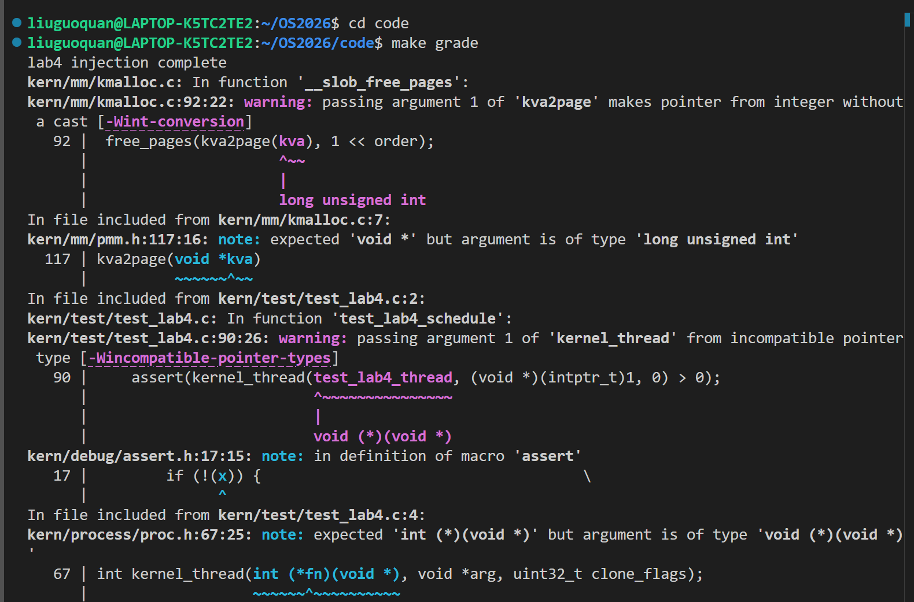
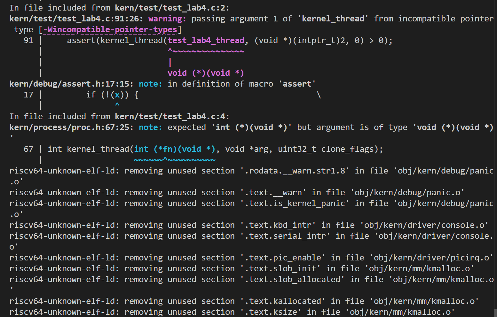
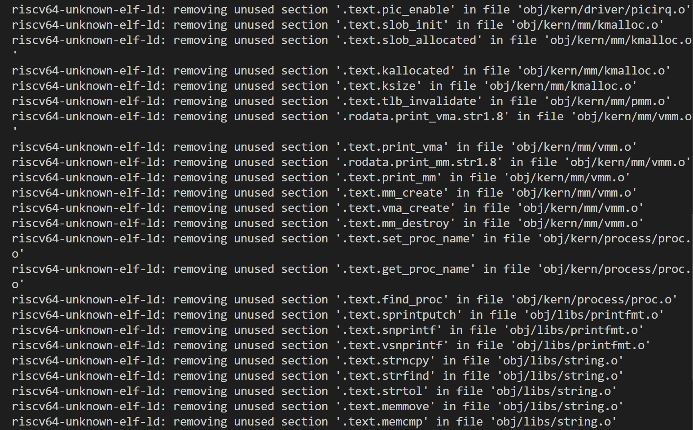
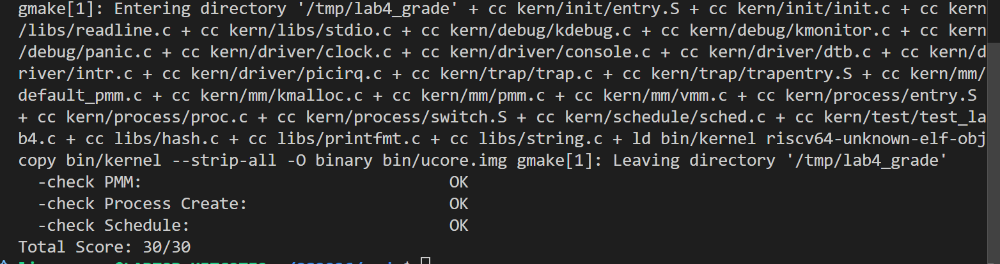

# 操作系统实验报告

## 实验基本信息

| 项目 | 内容 |
|------|------|
| **实验名称** | Lab4：进程管理 |
| **小组成员** | 2411822-刘国全、2411350-刘爽、2413423-王乐妍 |
| **完成日期** | 2026-11-18 |

### 小组分工

| 成员 | 负责的练习/模块 |
|------|----------------|
| 刘国全 | Lab2 PMM 依赖迁移、`page_init()`、`page_insert()`、`page_remove()`、VMM Challenge、`schedule()` 调度问题修复 |
| 刘爽 | `alloc_proc()`、`proc_init()`、`kernel_thread()`、`do_fork()`、`copy_thread()`、`copy_mm()`、`cpu_idle()`、`proc_run()` |
| 王乐妍 | Lab3 Trap 依赖迁移、`switch_to()`、`schedule()` 初版、测试与最终报告整合 |

### 报告分工

| 报告部分 | 负责人 | 协作人 |
|----------|--------|--------|
| 4.1 虚拟内存页操作 | 刘国全 | 刘爽 |
| 4.2 进程创建与初始化 | 刘爽 | 王乐妍 |
| 4.3 进程调度与上下文切换 | 王乐妍 | 刘国全 |
| 4.4 Lab2/Lab3 依赖迁移 | 刘国全、王乐妍 | 全员 |
| Challenge 与知识点 | 刘国全、王乐妍 | 刘爽 |
| 测试矩阵、截图与格式检查 | 王乐妍 | 全员 |

---

## 一、实验目的

本实验的主要目的是：

1. 理解虚拟内存中多级页表、页表项、TLB 和物理页引用计数之间的关系。
2. 实现 `page_insert()` 和 `page_remove()`，完成线性地址到物理页的映射维护。
3. 理解进程控制块 `struct proc_struct`、内核栈、上下文 `struct context` 和中断帧 `struct trapframe` 的作用。
4. 掌握内核线程的创建、初始化、首次运行和上下文切换过程。
5. 理解调度器如何从进程链表中选取下一个可运行线程，并通过 `proc_run()` 和 `switch_to()` 完成切换。
6. 使用 Prompt 驱动 AI 生成底层代码，并通过编译、测试和 GDB 调试验证实现。

---

## 二、实验环境

| 项目 | 内容 |
|------|------|
| 操作系统 | WSL2 Ubuntu |
| 目标架构 | RISC-V 64 |
| 内核地址空间 | Sv39，三级页表 |
| 交叉编译器 | `riscv64-unknown-elf-gcc` |
| 交叉调试器 | `riscv64-unknown-elf-gdb` |
| 模拟器 | `qemu-system-riscv64`；调试时使用 QEMU 4.1.1 调试版 |
| 构建工具 | GNU Make、Python 3 |
| 版本控制 | Git |

### AI 工具配置

| 成员 | AI 编程工具 | 底层模型 | 配置 |
|------|------------|---------|------|
| 刘国全 | Codex（VS Code/终端 Agent） | DeepSeek Flash（`deepseek-flash`） | 推理强度 high |
| 刘爽 | 豆包（桌面端） | 具体模型版本未记录 | 独立 WSL 环境补充验证 |
| 王乐妍 | Claude Code | DeepSeek Flash | 推理强度 high |

---

## 三、实验整体逻辑分析

### 3.1 本章逻辑主线

Lab4 从已经具备物理内存管理和 Trap 处理能力的内核出发，进一步建立虚拟内存映射、进程控制块、内核线程、上下文切换和进程调度能力。

完整执行链如下：

```text
kern_init
  -> pmm_init
  -> vmm_init
  -> proc_init
  -> cpu_idle
  -> schedule
  -> proc_run
  -> switch_to
  -> forkret -> forkrets -> __trapret -> kernel_thread_entry
```

三个功能模块的职责分别是：

1. **虚拟内存页操作**：维护页表项、物理页引用计数和 TLB 状态。
2. **进程创建与初始化**：构造 PCB、内核栈和初始 Trap frame，创建 `idleproc` 与 `initproc`。
3. **进程调度与上下文切换**：选择可运行线程，保存旧上下文并恢复新上下文，使线程能够真正运行。

### 3.2 功能的逐步实现

1. **迁移 Lab2/Lab3 依赖。**
   - 在 `default_pmm.c` 中恢复 Best-Fit 管理器。
   - 在 `pmm.c` 中实现 `page_init()`。
   - 在 `trap.c` 和 `trapentry.S` 中恢复中断、异常和 Trap 返回链。
2. **实现页表映射维护。**
   - `page_insert()` 建立或更新映射。
   - `page_remove_pte()` 删除页表项并维护引用计数。
   - `page_remove()` 提供幂等的解除映射接口。
3. **实现进程创建。**
   - `alloc_proc()` 初始化 PCB。
   - `proc_init()` 创建 `idleproc` 和 `initproc`。
   - `kernel_thread()` 构造内核线程首次运行所需的 Trap frame。
   - `do_fork()` 组合 PCB、内核栈、PID、链表和状态。
   - `copy_thread()` 构造新线程的首次运行上下文。
4. **实现调度。**
   - `cpu_idle()` 在需要调度时让出 CPU。
   - `schedule()` 按环形顺序选择可运行线程。
   - `proc_run()` 更新 `current`、切换页表并调用 `switch_to()`。
   - `switch_to()` 保存和恢复 callee-saved 寄存器。
5. **测试与调试。**
   - 依次验证 PMM、Process Create 和 Schedule。
   - 修复调度链表未回绕以及 `idleproc` 被错误优先选中的问题。

---

## 四、实验内容与实现

### 4.1 功能模块：虚拟内存页操作

**负责人：**2411822-刘国全

**涉及文件：**

- `code/kern/mm/pmm.c`
- `code/kern/mm/default_pmm.c`

#### 4.1.1 功能说明

`page_insert()` 负责把指定物理页映射到线性地址 `la`，并根据 `perm` 设置权限。`page_remove()` 负责删除已有映射。实现过程中必须同时维护：

```text
页表项内容
物理页引用计数
TLB 中的地址翻译缓存
```

#### 4.1.2 核心实现

```c
static void
page_remove_pte(pde_t *pgdir, uintptr_t la, pte_t *ptep)
{
    if (ptep != NULL && (*ptep & PTE_V)) {
        struct Page *page = pte2page(*ptep);
        if (page_ref_dec(page) == 0)
            free_page(page);
        *ptep = 0;
        tlb_invalidate(pgdir, la);
    }
}

int
page_insert(pde_t *pgdir, struct Page *page, uintptr_t la, uint32_t perm)
{
    pte_t *ptep = get_pte(pgdir, la, 1);
    if (ptep == NULL)
        return -E_NO_MEM;

    page_ref_inc(page);
    if (*ptep & PTE_V) {
        struct Page *old_page = pte2page(*ptep);
        if (old_page == page)
            page_ref_dec(page);
        else
            page_remove_pte(pgdir, la, ptep);
    }

    *ptep = pte_create(page2ppn(page), perm);
    tlb_invalidate(pgdir, la);
    return 0;
}
```

实现要点：

1. `get_pte(pgdir, la, 1)` 可能分配中间层页表页，失败时返回 `NULL`，因此必须返回 `-E_NO_MEM`。
2. 新物理页先增加引用计数。
3. 如果原地址已经映射到同一个物理页，先增加再减少引用计数，最终引用数不变。
4. 如果原地址映射到其他物理页，调用 `page_remove_pte()` 清除旧映射并减少旧页引用计数。
5. 最后写入新页表项并刷新 TLB。

`page_remove()` 的设计要求是幂等：如果目标地址没有有效映射，函数应安静返回，不能把正常的“未映射”情况当成异常。

#### 4.1.3 Spec

```text
Pre-Condition:
  pgdir 指向有效的页目录；
  page 指向有效的物理页描述符；
  la 为需要建立或删除映射的线性地址。

Post-Condition:
  page_insert 成功时，la 稳定映射到 page，权限等于 perm；
  page 的引用计数与映射次数一致；
  被替换的旧页引用计数正确减少；
  页表修改后对应 TLB 项失效。

Failure:
  get_pte 分配中间页表失败时返回 -E_NO_MEM；
  失败路径不能留下半完成映射；
  page_remove 在地址未映射时应直接返回。
```

#### 4.1.4 使用的 Prompt

对应 `report/prompt.md` 中的 **P03：实现 `page_insert()` 和 `page_remove()`**。

#### 4.1.5 验证状态

`check_pgdir()` 和 `check_boot_pgdir()` 均通过，并输出：

```text
check_pgdir() succeeded!
check_boot_pgdir() succeeded!
[Test PMM] PASS
```

---

### 4.2 功能模块：进程创建与初始化

**负责人：**2411350-刘爽

**涉及文件：**`code/kern/process/proc.c`

#### 4.2.1 功能说明

本模块负责创建 PCB、分配内核栈、构造首次运行 Trap frame，并把新线程挂入进程链表和 PID 哈希表。

主要函数：

```c
static struct proc_struct *alloc_proc(void);
void proc_init(void);
int kernel_thread(int (*fn)(void *), void *arg, uint32_t clone_flags);
int do_fork(uint32_t clone_flags, uintptr_t stack, struct trapframe *tf);
static void copy_thread(struct proc_struct *proc, uintptr_t stack, struct trapframe *tf);
static int copy_mm(uint32_t clone_flags, struct proc_struct *proc);
```

#### 4.2.2 核心实现

`alloc_proc()` 必须把 PCB 所有字段初始化到安全状态：

```c
proc->state = PROC_UNINIT;
proc->pid = -1;
proc->runs = 0;
proc->kstack = 0;
proc->need_resched = 0;
proc->parent = NULL;
proc->mm = NULL;
memset(&proc->context, 0, sizeof(struct context));
proc->tf = NULL;
proc->pgdir = boot_pgdir_pa;
proc->flags = 0;
memset(proc->name, 0, sizeof(proc->name));
```

`proc_init()` 的主要步骤：

1. 初始化 `proc_list` 和 PID 哈希表。
2. 创建 `idleproc`，设置 PID 为 0，复用 `bootstack`，并设置 `need_resched = 1`。
3. 设置 `current = idleproc`。
4. 调用 `kernel_thread(init_main, "Hello world!!", 0)` 创建 `initproc`。
5. 设置 `initproc` 的名称为 `"init"`。

`kernel_thread()` 构造一个临时 Trap frame：

```c
tf.gpr.s0 = (uintptr_t)fn;
tf.gpr.s1 = (uintptr_t)arg;
tf.epc = (uintptr_t)kernel_thread_entry;
tf.status = (read_csr(sstatus) | SSTATUS_SPP | SSTATUS_SPIE)
            & ~SSTATUS_SIE;
```

`copy_thread()` 把 Trap frame 放到新线程内核栈顶部，并设置：

```c
proc->tf = (struct trapframe *)(proc->kstack + KSTACKSIZE) - 1;
*proc->tf = *tf;
proc->tf->gpr.a0 = 0;
proc->tf->gpr.sp = (uintptr_t)proc->tf;
proc->context.ra = (uintptr_t)forkret;
proc->context.sp = (uintptr_t)proc->tf;
```

新线程第一次被调度时，执行链为：

```text
switch_to
  -> forkret
  -> forkrets
  -> __trapret
  -> sret
  -> kernel_thread_entry
  -> fn(arg)
```

`do_fork()` 按以下顺序组合资源：

```text
alloc_proc
  -> setup_kstack
  -> copy_mm
  -> copy_thread
  -> get_pid
  -> hash_proc
  -> 挂入 proc_list
  -> wakeup_proc
```

任何一步失败时都要按已获得资源逆序释放，避免 PCB 或内核栈泄漏。

#### 4.2.3 Spec

```text
Pre-Condition:
  current 指向当前执行线程；
  kernel_thread 提供合法的函数入口和参数；
  alloc_pages、kmalloc 和进程链表初始化已完成。

Post-Condition:
  idleproc 的 PID 为 0，状态为 PROC_RUNNABLE，kstack 为 bootstack；
  initproc 的 PID 为 1，状态为 PROC_RUNNABLE；
  initproc 已挂入 proc_list 和 PID 哈希表；
  initproc 的 context.ra 指向 forkret；
  initproc 的 context.sp 和 tf 指向其内核栈中的 Trap frame。

Failure:
  PCB 或内核栈分配失败时返回负错误码；
  失败路径必须释放已获得资源；
  不允许把未初始化 PCB 或未挂接的线程设置为可运行。
```

#### 4.2.4 使用的 Prompt

对应 `report/prompt.md` 中的 **P04：实现进程创建与初始化**。

#### 4.2.5 验证状态

```text
[Test Process Create] PASS
check Process Create: OK
```

测试验证了 `idleproc`、`initproc`、PID、状态、父进程、内核栈、Trap frame 和上下文关键字段。

---

### 4.3 功能模块：进程调度与上下文切换

**负责人：**2413423-王乐妍；刘国全协助修复调度链表回绕问题

**涉及文件：**

- `code/kern/process/proc.c`
- `code/kern/schedule/sched.c`
- `code/kern/process/switch.S`

#### 4.3.1 功能说明

`cpu_idle()` 是空闲线程主体，持续检查 `current->need_resched`。

`schedule()` 负责从进程链表中寻找下一个 `PROC_RUNNABLE` 线程。

`proc_run()` 负责更新 `current`、切换页表并调用 `switch_to()`。
`switch_to()` 只负责保存和恢复 callee-saved 寄存器。

#### 4.3.2 核心实现

`switch_to()` 只保存 `ra`、`sp` 和 `s0~s11`：

```asm
sd ra, 0*REGBYTES(a0)
sd sp, 1*REGBYTES(a0)
sd s0, 2*REGBYTES(a0)
...
ld ra, 0*REGBYTES(a1)
ld s0, 2*REGBYTES(a1)
...
ld sp, 1*REGBYTES(a1)
ret
```

原因是指针和临时寄存器属于 caller-saved，编译器会在普通函数调用中负责保存；`s0~s11` 属于 callee-saved，必须由上下文切换代码保存。

`proc_run()` 在关中断的临界区中完成：

```c
current = proc;
proc->runs++;
write_csr(satp, 0x8000000000000000ULL |
         ((uintptr_t)proc->pgdir >> RISCV_PGSHIFT));
switch_to(&prev->context, &proc->context);
```

#### 4.3.3 调度问题与修复

初版 `schedule()` 从当前线程的下一个节点开始查找，但扫描到链表尾后没有回到链表头；同时把 `idleproc` 当成普通可运行线程，导致测试线程尚未运行时系统就切回 idleproc。

修复后的逻辑：

1. 当前线程不是 idleproc 时，从它的下一个节点开始。
2. 如果当前线程是链表最后一个节点，则从链表第一个节点开始。
3. 扫描到链表头后回绕继续查找，形成完整的环形遍历。
4. 正常调度时跳过 `idleproc` 和当前线程。
5. 只有找不到其他可运行线程时，才回退到 `idleproc`。

修复后 `[Test Schedule] PASS`，并输出：

```text
this initproc, pid = 1, name = "init"
To U: "Hello world!!".
To U: "en.., Bye, Bye. :)"
```

#### 4.3.4 Spec

```text
Pre-Condition:
  proc_list 已完成初始化；
  current 指向当前运行线程；
  idleproc 已存在。

Post-Condition:
  schedule 选择一个 PROC_RUNNABLE 的非 idle 线程；
  若没有其他可运行线程，则选择 idleproc；
  选中的线程通过 proc_run 和 switch_to 获得 CPU；
  current、satp 和上下文保持一致。

Failure:
  不能在关闭中断后遗漏恢复中断状态；
  不能重复选择当前线程；
  不能因为链表遍历不回绕而永久跳过可运行线程。
```

#### 4.3.5 使用的 Prompt

- **P05：实现调度与上下文切换**
- **P06：修复调度链表回绕问题**

#### 4.3.6 验证状态

```text
[Test Schedule] PASS
check Schedule: OK
Total Score: 30/30
```

---

### 4.4 Lab2/Lab3 依赖代码迁移

#### 4.4.1 Lab2 PMM 迁移

**负责人：**2411822-刘国全

Lab4 的 `default_pmm.c` 需要提供 Best-Fit 管理器和 `best_fit_check()` 所需的空闲链表状态。由于 Lab4 骨架缺少 `best_fit_pmm.h`，且 `pmm.c` 固定引用 `default_pmm_manager`，最终把 Best-Fit 实现放在 `default_pmm.c` 中，并导出为：

```c
const struct pmm_manager default_pmm_manager = {
    .name = "best_fit_pmm_manager",
    .init = best_fit_init,
    .init_memmap = best_fit_init_memmap,
    .alloc_pages = best_fit_alloc_pages,
    .free_pages = best_fit_free_pages,
    .nr_free_pages = best_fit_nr_free_pages,
    .check = best_fit_check,
};
```

`page_init()` 根据 DTB 获取物理内存范围，在 kernel `end` 后建立 `Page` 描述符数组，将固件、内核和描述符区域标记为保留，再把剩余完整物理页交给 PMM。

#### 4.4.2 Lab3 Trap 迁移

**负责人：**2413423-王乐妍

需要恢复：

- `RESTORE_ALL`
- `__alltraps`
- `interrupt_handler()`
- `exception_handler()`

`forkret -> forkrets -> __trapret` 的首次运行链依赖 Lab3 的上下文恢复代码。特别地，`forkrets` 会把新线程的 Trap frame 作为栈指针，随后 `__trapret` 恢复 CSR 和通用寄存器并执行 `sret`。

#### 4.4.3 验证状态

依赖代码并入后，内核能够正常启动，PMM、VMM、进程创建和调度测试均通过。

---

## 五、测试与验证

### 5.1 测试环境说明

测试在 WSL2 的 `~/OS2026/code` 目录下执行：

```bash
make clean
make
make grade
```

当前最终结果：

```text
-check PMM:                                OK
-check Process Create:                     OK
-check Schedule:                           OK
Total Score: 30/30
```

### 5.2 测试矩阵

| 测试 | 验证内容 | 结果 |
|------|----------|------|
| PMM | `page_insert()`、`page_remove()`、引用计数、页表项和 TLB | PASS |
| Process Create | `idleproc`、`initproc`、PCB 字段、内核栈和上下文 | PASS |
| Schedule | `schedule()`、`proc_run()`、`switch_to()` 和多线程运行 | PASS |

### 5.3 测试截图

以下截图按实际执行顺序保留了 `make grade` 的构建、编译警告、链接输出和最终评分。编译警告来自测试框架的参数类型和 `kmalloc.c` 中原有代码，不影响最终测试结果；链接器输出是 `--gc-sections` 删除未使用 section 的正常信息。









### 5.4 测试结果分析

1. PMM 测试通过，说明物理页管理、页表项更新、引用计数和 TLB 失效逻辑正确。
2. Process Create 测试通过，说明 `idleproc` 和 `initproc` 的 PCB 字段、内核栈和首次运行上下文设置正确。
3. Schedule 测试通过，说明调度器能够找到可运行线程，并且 `proc_run()` 和 `switch_to()` 能完成上下文切换。
4. 调度修复前总分为 20/30；补全环形扫描逻辑后达到 30/30。

---

## 六、Challenge

### 6.1 `local_intr_save/restore` 如何实现开关中断

`__intr_save()` 读取 `sstatus.SIE`：

- 如果原来开启中断，则调用 `intr_disable()` 关闭中断并返回 1；
- 如果原来已经关闭中断，则返回 0，不改变状态。

`__intr_restore(flag)` 只有在 `flag == 1` 时才重新开启中断。这样能保证临界区退出后恢复的是进入前的状态，而不是无条件开启中断。

`do { } while (0)` 让多语句宏在语法上表现得像一条普通语句，避免破坏 `if/else` 结构。

### 6.2 `sv32`、`sv39`、`sv48` 的异同

三者都是分页模式，虚拟地址和物理地址被划分为若干级页表索引加页内偏移：

| 模式 | 虚拟地址宽度 | 页表级数 | 每级索引位数 | 页大小 |
|------|--------------|----------|--------------|--------|
| Sv32 | 32 位 | 2 | 10 + 10 | 4 KiB |
| Sv39 | 39 位 | 3 | 9 + 9 + 9 | 4 KiB |
| Sv48 | 48 位 | 4 | 9 + 9 + 9 + 9 | 4 KiB |

Sv32 的 PTE 为 4 字节；Sv39/Sv48 的 PTE 通常为 8 字节。三者的中间层查找逻辑相似，因此 `get_pte()` 中多次出现形式相近的代码。

### 6.3 `get_pte()` 是否应该拆分

当前 `get_pte()` 同时承担“查找页表项”和“按需分配中间页表”的职责。

优点：

- 调用者只需一次调用就能获得可写的页表项；
- 简化 `page_insert()` 等上层接口。

缺点：

- 查找和分配耦合，调用者无法只查询而不产生分配；
- 失败路径和资源管理更复杂；
- 调试时较难区分“页表不存在”和“页表项不存在”。

可以拆分为：

```c
pte_t *walk_pte(pde_t *pgdir, uintptr_t la);
int ensure_pte(pde_t *pgdir, uintptr_t la, pte_t **ptep);
```

前者只负责查找，后者负责在需要时分配中间页表，职责更清晰。

---

## 七、实验总结与收获

### 7.1 对操作系统的理解

| 本实验知识点 | 对应 OS 原理 |
|--------------|--------------|
| 多级页表和 PTE | 虚拟地址到物理地址的翻译 |
| `page_insert/page_remove` | 映射建立、撤销和引用计数 |
| TLB 刷新 | 页表更新后的地址翻译一致性 |
| PCB 和进程状态 | 进程/线程的管理实体 |
| 内核栈 | 内核执行流和 Trap frame 的保存位置 |
| `struct context` | 进程切换时保存的最小 CPU 上下文 |
| `switch_to` | callee-saved 寄存器的保存与恢复 |
| 进程链表和调度 | 就绪队列与 CPU 分配 |
| `local_intr_save/restore` | 单核临界区保护 |

### 7.2 AI 协作开发经验

1. **先约定数据结构，再生成代码。** `struct proc_struct`、`struct context` 和 `struct trapframe` 决定字段偏移和调用链，必须与已有汇编严格一致。
2. **Prompt 要写出失败路径。** `page_insert()` 中 `get_pte()` 失败、替换旧页、重复映射等边界情况必须在 Spec 中提前说明。
3. **测试失败要结合调度路径分析。** 本次 Schedule 失败并非上下文切换本身错误，而是调度链表没有回绕，导致 `initproc` 创建出的测试线程一直没有被选中。
4. **编译通过不等于功能正确。** `switch_to` 和 `schedule` 都能编译，但只有实际运行测试才能发现调度顺序问题。
5. **不能修改测试函数来迎合评分。** 修复应集中在 `schedule()`，保持测试和评分脚本不变。

### 7.3 AI 生成 Bug 与解决过程

#### Bug 1：Lab4 骨架缺少 `best_fit_pmm.h`

- 现象：`default_pmm.c` 包含不存在的头文件。
- 原因：Lab4 骨架改用了 `default_pmm_manager`，但测试仍叫 `best_fit_check`。
- 解决：把 Best-Fit 函数直接实现到 `default_pmm.c`，删除不存在的头文件依赖，并导出 `default_pmm_manager`。

#### Bug 2：调度器不回到链表头

- 现象：PMM 和 Process Create 通过，Schedule 失败，QEMU 只重复输出 `100 ticks`。
- 原因：`schedule()` 扫描到链表尾后停止，且过早选择 `idleproc`，导致测试线程没有机会执行。
- 解决：实现环形链表扫描，跳过 idleproc 和 current，找不到其他线程时才回退到 idleproc。

#### Bug 3：PCB 未初始化字段风险

- 现象：进程创建对字段要求严格，未初始化字段可能让调度器或测试读到随机值。
- 解决：`alloc_proc()` 对状态、PID、父进程、上下文、Trap frame、页目录、名称和链表节点全部显式初始化。

#### Bug 4：首次运行链路难以直接调试

- 现象：新线程创建成功，但不能直接确认其首次执行路径。
- 解决：通过 GDB 逐步验证：

```text
schedule -> proc_run -> switch_to -> forkret -> forkrets
         -> __trapret -> kernel_thread_entry -> init_main
```

最终确认 `initproc` 能正常输出：

```text
this initproc, pid = 1, name = "init"
To U: "Hello world!!".
To U: "en.., Bye, Bye. :)"
```

### 7.4 本实验未覆盖的重要 OS 知识点

- 用户进程独立地址空间的复制与隔离；
- 缺页异常和按需分页；
- 文件描述符和进程资源管理；
- 完整的进程退出、僵尸进程回收和父进程等待；
- 多核调度、锁、内存序和跨核 TLB shootdown；
- 抢占式调度和时间片轮转；
- 用户态与内核态之间的系统调用参数检查。

---

## 八、提交检查

- [x] Lab2 依赖代码已迁移
- [x] Lab3 依赖代码已迁移
- [x] `page_insert()` 和 `page_remove()` 已实现
- [x] 进程创建相关函数已实现
- [x] 调度与上下文切换已实现
- [x] `make grade` 通过，得分 30/30
- [x] 报告和 Prompt 完成
- [x] 测试截图已放入 `report/images/`
- [x] 代码中的 `YOUR CODE` 已替换为学号
